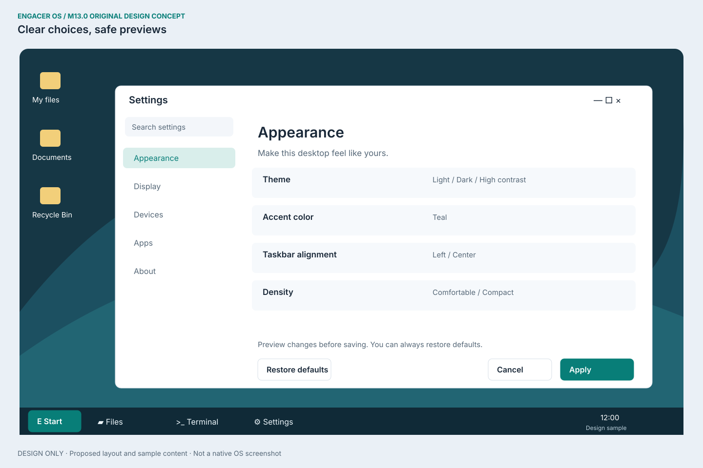
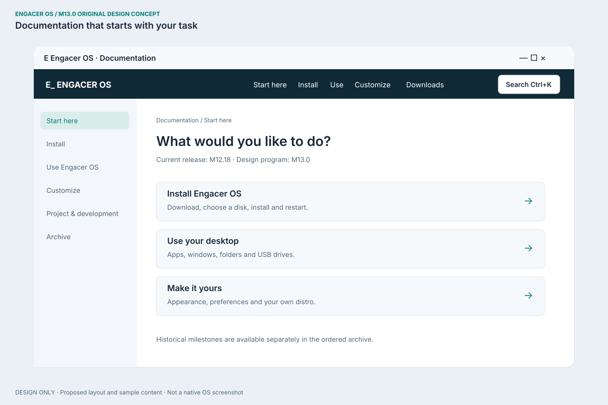

# M13 product design contract

M13.0 design baseline, 17 November 2026, with staged native implementation. M13.1 shared controls, M13.2 welcoming setup and M13.3 disk tools have separate exact-media native qualification. M13.4 progress/recovery, M13.5 desktop/windows, M13.6 Start/taskbar and M13.7 Files also pass their separate exact native and public qualifications. M13.8 and M13.9 native and public qualifications pass within their recorded scopes. M13.10 secondary-surface finishing is in development; later proposals are not shipped M13 features. Stability qualification remains exclusively M13.13. [Ordered stages](../milestones/m13.md), [inventory](m13-inventory.md), [website](website-m13.md).

## Direction: calm, familiar, unmistakably Engacer

Use modern desktop hierarchy with predictable Windows-style mouse/keyboard conventions and original Engacer identity. Keep working M12 navigation, transactions, boot paths and ownership. Refine proportions and whole journeys before adding decorative effects. An OS window should not resemble an oversized web form.

Original concept gallery (all design-only): [Setup](figures/m13/setup.svg), [Disk selection](figures/m13/disks.svg), [Desktop and Files](figures/m13/desktop.svg), [Start](figures/m13/start.svg), [Settings](figures/m13/settings.svg), [Documentation portal](figures/m13/portal.svg). The [tokens](m13-tokens.json) are a design input, not evidence that native controls already consume them. The [search prototype](../../website/design-m13/search-prototype.html) is an offline interaction demonstration, not the production search.

## Common geometry and states

Logical units scale with display size; density is a separate preference. Body 16, supporting 14, section 20, page heading 28, hero 36. Use existing licensed Inter, measured wrapping and consistent baseline alignment. Base spacing 4 with 8/12/16/24/32 grouping. Normal control height 36, setup primary 44, pointer target at least 32; touch support remains separately qualified. Title bars normally 36–40, taskbar 48, Files sidebar 192–224. These are default targets to fit by measured content, not excuses to clip text.

Use an off-white content surface, dark ink, a restrained teal accent, original wallpaper and recognizable app silhouettes. Dark and high contrast use semantic roles, not independent layouts. Subtle depth cannot require a full-screen blur buffer. Selected, inactive-selected, focus, hover and pressed are distinct. Never use accent on every ordinary button.

Review all essential labels at compact 1024x768 and ordinary 1920x1080, plus actual 3840x2160 at supported scale. Long user content may ellipsize only with full-name access; primary actions and essential errors may not. Minimum window dimensions must preserve navigation. No text-only letter badges as normal app identity.

## Complete journeys

Setup: Welcome -> keyboard/display -> target -> recommended/advanced choices -> explicit review -> real progress -> restart -> installed desktop. Presentation may consolidate choices, but storage consent and actual effects stay explicit. A non-destructive Back path preserves values until writes begin. Disk tools use readable disk/partition rows and independently guarded actions.

Desktop: single-click selects; double-click/Enter opens. Press/release ownership, right-click selection rules, drag threshold, cursor types, scroll direction and keyboard commands share one contract. Window captions, snap previews, active state and restore bounds remain consistent. Long drags must not lose the window or its recovery route.

Files: stable Back/Forward/Up/breadcrumbs, compact command bar, recognizable places, content-first list/grid and concise status. Empty/no-device/error states preserve the frame and offer recovery. Copy/move/cancel/conflict feedback is tied to actual operation state, not invented progress. USB capabilities remain bounded.

Start/taskbar: recognizable app grid, local search, All apps, optional categories, clear power/account actions. Running/pinned/grouped/minimized state must map to actual windows. Settings: stable categories, supported search, preview/apply/cancel/reset and actual saved effects. Ordinary app windows and secondary dialogs use the same components.

## Performance and evidence

Reference target profiles and response/frame targets are in the milestone contract. Record M12.18's fixed state (553,452 bytes), actual framebuffer/cache cost and retained/peak allocations separately. Do not infer a latency baseline from host raster throughput. M13.0 sets targets; first native measurements belong to M13.1 and must precede native changes. Preserve CPU halt at idle, bounded effects, reduced motion and optional-app independence.

For every stage show actual native before/after frames and complete tasks. Original concepts, automated checks, agent visual judgment, owner feedback and human novice studies are separate evidence. No claim of Windows capability parity, universal hardware, screen-reader support or vendor GPU acceleration follows from this design.

## Decisions and alternatives

- Refine the native renderer and shared tokens: preserves the independent OS and bounded resources. A browser-powered desktop or wholesale toolkit replacement would introduce a new stack without proving the user's journeys.
- Use original Engacer assets and existing licensed fonts: familiar affordances without copying proprietary Windows artwork.
- One coherent default plus supported customization: a novice should not need to design a desktop before using it. Unimplemented theme options are refused, not stored as fake settings.
- Keep advanced disk controls optional: fewer ordinary decisions without concealing erase consent or unsupported data-preserving operations.
- Finish every secondary surface before hardware priority: no planned legacy visual exceptions behind a polished main screen.

## Original concept sheets — design only

### Setup

### Disk selection

### Desktop and Files

### Start

### Settings

### Documentation portal

## M13.6 Start and taskbar implementation

Use the existing original icon catalogue and bounded app/pin results, with a 96-unit tile stride and shared adaptive column count for drawing, pagination and arrows. A tile has an 88-unit hit rectangle; search and List remain 56-unit descriptive rows. This changes presentation without a new index worker, preference schema, allocated per-item surface or process. Taskbar app groups use a 112-unit stride and quiet unopened-pin state; live window count, active/shown/minimized indicators, stable pin/MRU order and generation-bound window menus are preserved. Capacity computation uses the same stride and reserves the existing Start, overflow and provider-tray areas. Actual unavailable-provider labels stay truthful. Native qualification/publication remain separate from implementation.

The matching M13.6 native qualification passes its five complete display/Start profiles, applied-theme tasks, grouped-window/provider ownership, independent layout persistence and exact enabled-device VMware starter. Native fixed desktop/installer/font state remains unchanged, named completed tasks retain zero managed pages and idle CPUs halt. Corrected theme proof explicitly Applies Dark before closing Settings; cancelled previews stay diagnostic. Public publication and later M13 integration remain separate.

## M13.7 current-folder filtering

M13.7 implementation: a fixed 88-byte record per existing Files window binds query and caret to its generation token. The native bounded name scan reuses the existing sorted listing; even empty results rebuild that cache before drawing. Query changes clear invisible selection, navigation clears queries, and successful creates/copies/moves reveal their resulting name. No background index or heap cache is added. USB filtering remains explicitly unavailable. Common frame/places/footer changes preserve provider identity, mutation consent and safe removal. M13.7 exact-media native and public qualification subsequently passed; see its milestone and publication receipt.

## M13.8 Settings search and feedback

Native implementation: eight generation-bound fixed search records reuse the existing Settings categories and checked preview transaction. Search result commands open real categories; no device controls or persistence are invented. Empty search hints use semantic muted colors in Settings and Start. Settings has a 700x600 minimum and an 800x650 initial window to fit the extra row with its existing footer. Appearance/display keep Apply/Cancel; input/accessibility retain labelled immediate saves. Shell messages prefer lower workspace corners and scan above intersecting captions with bounded work; if every ordinary corner is crowded, the focused caption remains protected. This changes neither file-dialog ownership nor the explicit Dismiss action.

M13.8 observers cache only immutable map symbol locations and set TCP_NODELAY on the owned QMP client. Every mutable guest value is still freshly read. This reduces host observation overhead; its settling times are not native FPS or latency. Exact native qualification and complete public delivery pass. The recorded secondary-surface finishing items remain assigned to M13.10 before final M13.12.

M13.8 display admission checks physical dimensions against an 800x660 logical desktop before mutating scale, so the new 600-high Settings frame fits above the reserved taskbar. Startup sanitizes a formerly valid saved undersized workspace to Automatic for the session, retaining its valid appearance and personal files. The existing warning word distinguishes unreadable appearance (1) from saved-size fallback (2); actual Apply clears the warning and saves the current scale. The added 1920x1200/200% refusal and legacy-record startup tasks must qualify the corrected artifact, not the earlier complete candidate.

## Owner addition: long uptime and screensaver

The owner reported a long-uptime freeze on released M13.7 on 18 November 2026. Duration and cause are not established. Keep a new owned M13.7 baseline separate from immutable accepted evidence. M13.9 must distinguish a live idle CPU from stalled interrupts, full input queues, a blocked renderer, operation state and memory growth; genuine elapsed-time tests cannot be substituted by advancing a counter. M13.12 repeats the corrected real-duration journey. No freeze fix is claimed by the current M13.8 Settings work.

M13.11 adds an optional bounded native screensaver with actual idle timeout, supported preview/settings and safe mouse/keyboard wake. Preserve the desktop, windows and unsaved data; consume the wake gesture so it does not click through or leave a stuck key/drag. Do not turn it into a fake authentication screen, background polling worker or dependency on optional applications. Honor reduced motion; validate stored data and distribution defaults. The saver is not a workaround for the reported hang.

## M13.9 presentation recovery candidate

Implementation in progress; no native qualification is claimed. The M13.7 baseline retains serial input processing while its image stops updating. The existing SVGA quarantine discards FIFO ownership in software without clearing the device CONFIG_DONE register. The candidate clears that register before discarding the pointer, retains the same firmware mode/shadow buffer and replays the full framebuffer once after the ownership change. Subsequent CPU writes must be visibly observed on the actual device; a serial-only assertion is insufficient. The change adds no new fixed state, framebuffer or idle loop. Real-duration and native motion measurements remain blocking before release. [Stage plan](../milestones/m13-9.md).

## Stability priority and M13.13 extension

Frequent freezes are now reported on M13.8 as well as M13.7. Historic task-level qualification does not establish stability; current M13.8 media are testing-only. The owner explicitly requires finishing M13.9-M13.12 before stability work begins in M13.13. M13.12 remains integration qualification; [M13.13](../milestones/m13-13.md) adds an eight-real-hour release-blocking stability trial before hardware expansion. Pending M13.9 trace and timeout self-test code is unqualified until rebuilt and tested on frozen media.

## Current M13.9 motion and pointer implementation

The frozen motion candidate composes the union of old/new exposed strips once around the reused window interior. Independent full-repaint comparisons cover off-screen clipping and ordinary/150%/physical-4K scales. It reuses the existing shadow/framebuffer and allocates no per-window pixel cache.

Original geometric text and axial/diagonal resize cursors follow native semantic hit targets. Their centered hotspots retain the actual input coordinates and signed clipping keeps framebuffer writes within the current physical output. Arrow behavior is retained on captions and ordinary controls. Cursor kind adds four fixed core bytes, with no bitmap allocation or idle animation. Existing very-low-resource direct rendering retains its legacy arrow fallback rather than allocating another surface.

A bounded 64-entry native pointer ring records receipt and completed CPU/framebuffer/cursor presentation separately from external scanout. Net desktop-state growth is 2,560 bytes against M13.8; USB receipt timestamps add 16 bytes outside that desktop total. The existing validated HPET divisor supplies interpolation without a second clock, background worker or polling loop. Button-edge receipt timestamps retain their conservative 10-ms rounding. Configured RAM, fixed state, framebuffer/shadow bytes and managed peak/retained pages remain separate.

The owner explicitly requires finishing M13.9-M13.12 before any further stability investigation. Earlier failure/recovery diagnostics remain preserved; they do not qualify the current candidate or a stable release. Natural-freeze reproduction, duration trials and reset-chain diagnosis resume only in M13.13.
