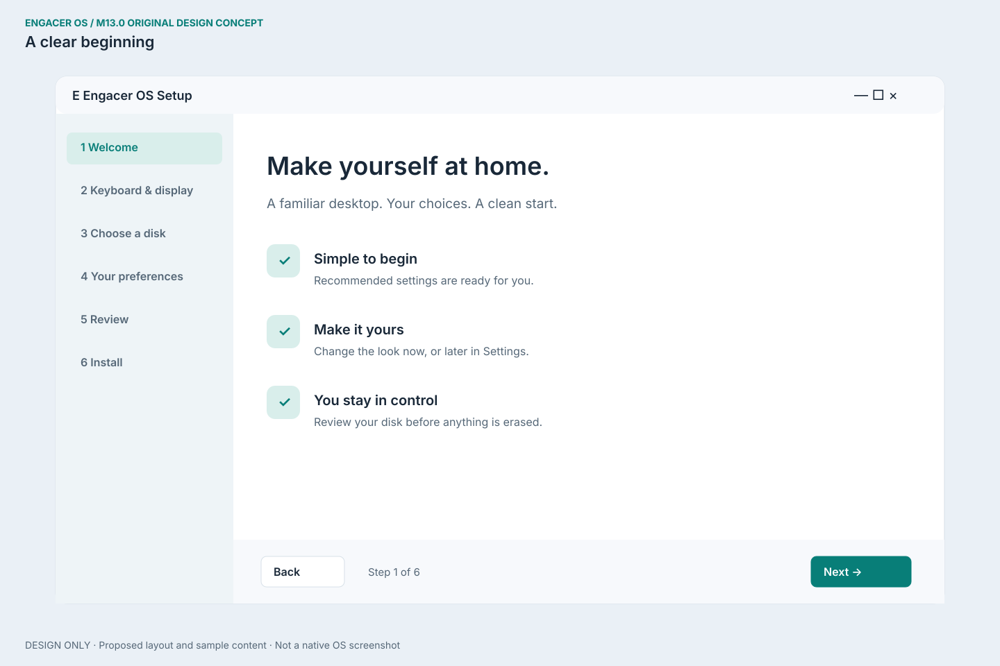
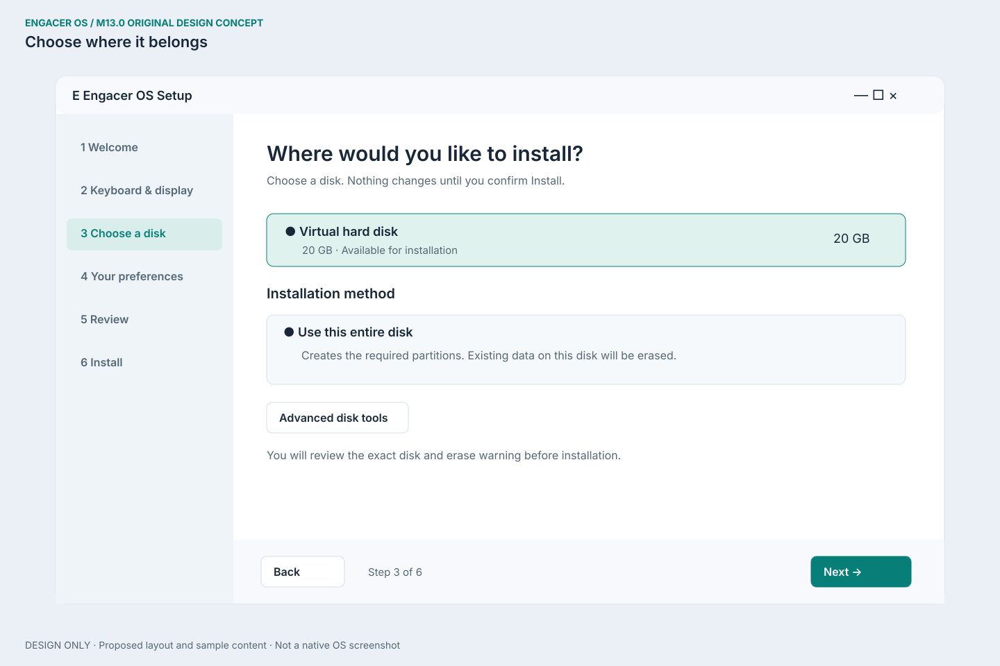
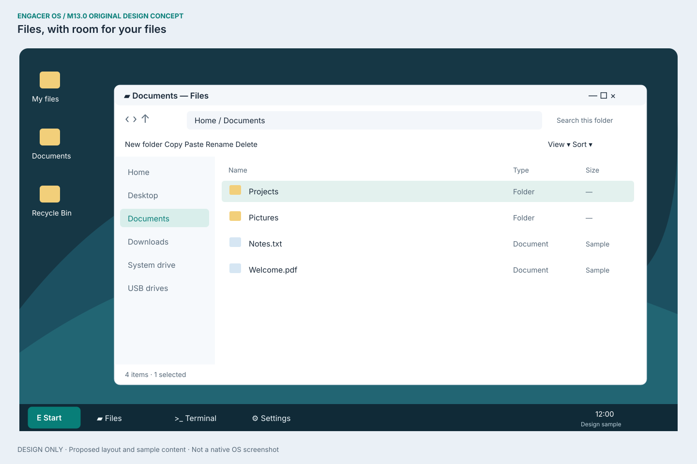
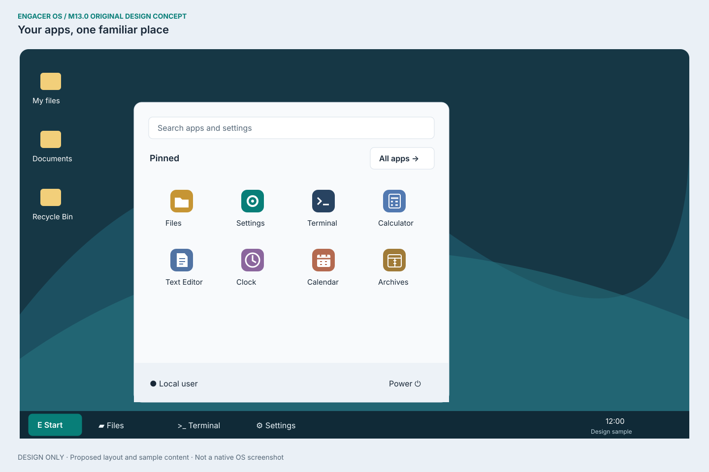

# M13 product design contract

M13.0 design baseline, 17 November 2026, with staged native implementation. M13.1 shared controls, M13.2 welcoming setup and M13.3 disk tools have separate exact-media native qualification. M13.4 progress, recovery and fourteen-profile VMware startup now pass exact native qualification; later proposals are not shipped M13 features. [Ordered stages](../milestones/m13.md), [inventory](m13-inventory.md), [website](website-m13.md).

## Direction: calm, familiar, unmistakably Engacer

Use modern desktop hierarchy with predictable Windows-style mouse/keyboard conventions and original Engacer identity. Keep working M12 navigation, transactions, boot paths and ownership. Refine proportions and whole journeys before adding decorative effects. An OS window should not resemble an oversized web form.

Original concept gallery (all design-only): [Setup](figures/m13/setup.svg), [Disk selection](figures/m13/disks.svg), [Desktop and Files](figures/m13/desktop.svg), [Start](figures/m13/start.svg), [Settings](figures/m13/settings.svg), [Documentation portal](figures/m13/portal.svg). The [tokens](m13-tokens.json) are a design input, not evidence that native controls already consume them. The [search prototype](../../website/design-m13/search-prototype.html) is an offline interaction demonstration, not the production search.

## Common geometry and states

Logical units scale with display size; density is a separate preference. Body 16, supporting 14, section 20, page heading 28, hero 36. Use existing licensed Inter, measured wrapping and consistent baseline alignment. Base spacing 4 with 8/12/16/24/32 grouping. Normal control height 36, setup primary 44, pointer target at least 32; touch support remains separately qualified. Title bars normally 36–40, taskbar 48, Files sidebar 192–224. These are default targets to fit by measured content, not excuses to clip text.

Use an off-white content surface, dark ink, a restrained teal accent, original wallpaper and recognizable app silhouettes. Dark and high contrast use semantic roles, not independent layouts. Subtle depth cannot require a full-screen blur buffer. Selected, inactive-selected, focus, hover and pressed are distinct. Never use accent on every ordinary button.

Review all essential labels at compact 1024x768 and ordinary 1920x1080, plus actual 3840x2160 at supported scale. Long user content may ellipsize only with full-name access; primary actions and essential errors may not. Minimum window dimensions must preserve navigation. No text-only letter badges as normal app identity.

## Complete journeys

Setup: Welcome -> keyboard/display -> target -> recommended/advanced choices -> explicit review -> real progress -> restart -> installed desktop. Presentation may consolidate choices, but storage consent and actual effects stay explicit. A non-destructive Back path preserves values until writes begin. Disk tools use readable disk/partition rows and independently guarded actions.

Desktop: single-click selects; double-click/Enter opens. Press/release ownership, right-click selection rules, drag threshold, cursor types, scroll direction and keyboard commands share one contract. Window captions, snap previews, active state and restore bounds remain consistent. Long drags must not lose the window or its recovery route.

Files: stable Back/Forward/Up/breadcrumbs, compact command bar, recognizable places, content-first list/grid and concise status. Empty/no-device/error states preserve the frame and offer recovery. Copy/move/cancel/conflict feedback is tied to actual operation state, not invented progress. USB capabilities remain bounded.

Start/taskbar: recognizable app grid, local search, All apps, optional categories, clear power/account actions. Running/pinned/grouped/minimized state must map to actual windows. Settings: stable categories, supported search, preview/apply/cancel/reset and actual saved effects. Ordinary app windows and secondary dialogs use the same components.

## Performance and evidence

Reference target profiles and response/frame targets are in the milestone contract. Record M12.18's fixed state (553,452 bytes), actual framebuffer/cache cost and retained/peak allocations separately. Do not infer a latency baseline from host raster throughput. M13.0 sets targets; first native measurements belong to M13.1 and must precede native changes. Preserve CPU halt at idle, bounded effects, reduced motion and optional-app independence.

For every stage show actual native before/after frames and complete tasks. Original concepts, automated checks, agent visual judgment, owner feedback and human novice studies are separate evidence. No claim of Windows capability parity, universal hardware, screen-reader support or vendor GPU acceleration follows from this design.

## Decisions and alternatives

- Refine the native renderer and shared tokens: preserves the independent OS and bounded resources. A browser-powered desktop or wholesale toolkit replacement would introduce a new stack without proving the user's journeys.
- Use original Engacer assets and existing licensed fonts: familiar affordances without copying proprietary Windows artwork.
- One coherent default plus supported customization: a novice should not need to design a desktop before using it. Unimplemented theme options are refused, not stored as fake settings.
- Keep advanced disk controls optional: fewer ordinary decisions without concealing erase consent or unsupported data-preserving operations.
- Finish every secondary surface before hardware priority: no planned legacy visual exceptions behind a polished main screen.

## Original concept sheets — design only

### Setup

### Disk selection

### Desktop and Files

### Start

### Settings

### Documentation portal

