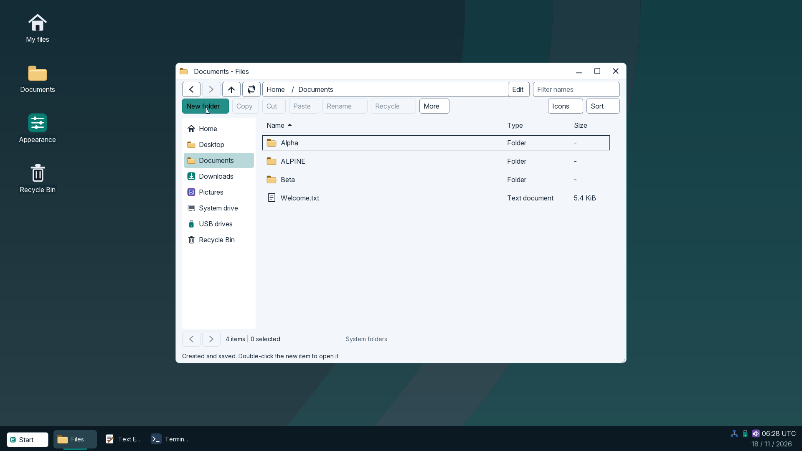
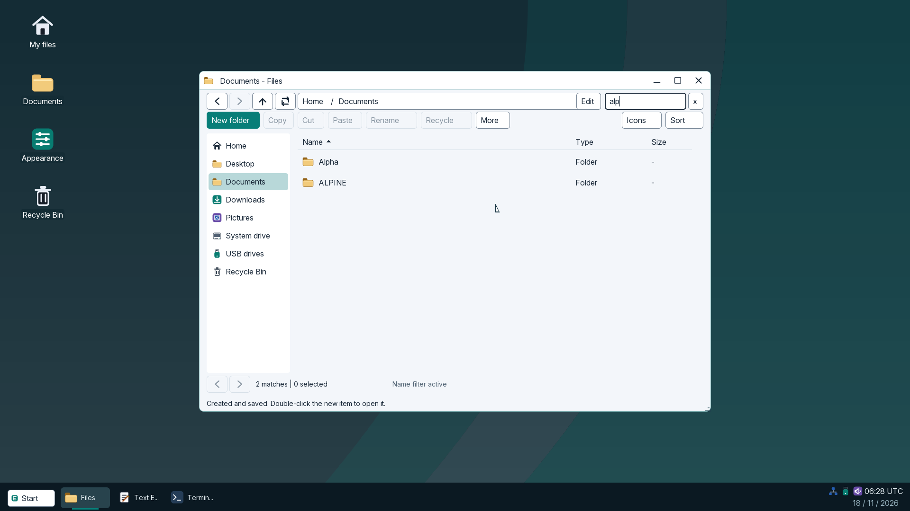
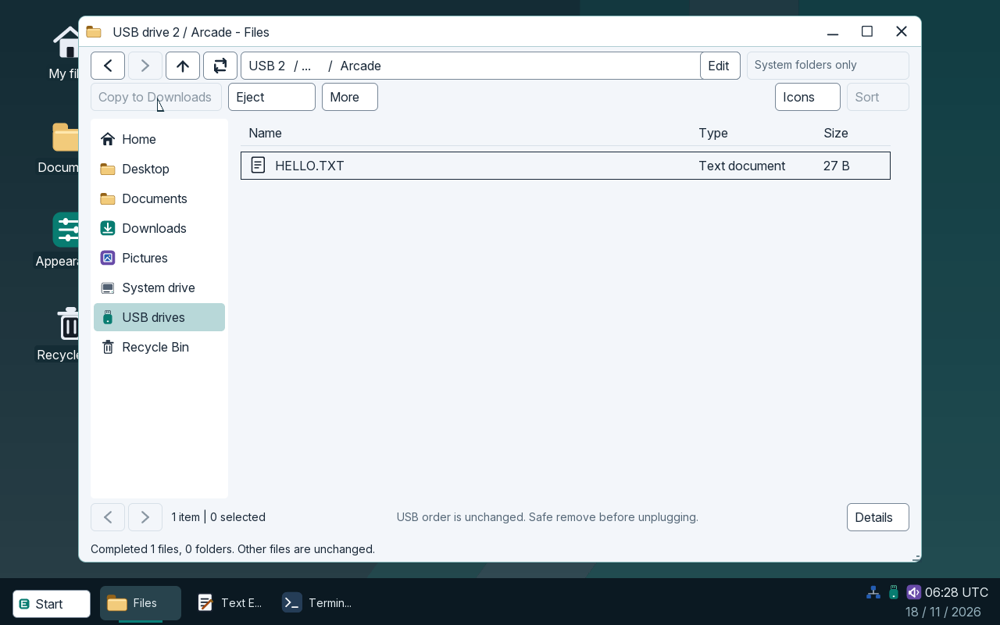

# Files - navigation and current-folder filtering

M13.7 passes its named native qualification. Use the [matching release](../releases/m137-v0.13.7.md) and [installation guide](install-m137.md). Complete public website verification remains a separate gate.

## Find your way

Open Files from Start or the taskbar. The left sidebar contains Home, Desktop, Documents, Downloads, Pictures, the system drive, USB drives and Recycle Bin. A small window uses Places instead of the sidebar. Back and Forward retrace visited locations; Up opens the parent folder. Refresh checks the same location. A very narrow address area becomes an explicit Address button. Click Address, the address area or Edit to enter a native path or supported USB address.

Click an item once to select it. Double-click or press Enter to open the selected folder. Use Icons or Details to change the view, and Sort for native folder ordering. More contains additional commands that may not fit the compact toolbar. Right-click and the existing keyboard shortcuts remain available. Previous/next arrows at the bottom change item pages, not navigation history.

## Filter names in this folder

Click Filter names or press Ctrl+F. Type part of a displayed name. Letter case does not matter; the filter checks only the current native system folder, not its descendants or file contents. The field accepts up to 63 ordinary ASCII characters and has no background index. The count changes to matches. A changed filter clears old selection and starts at the first page so hidden files cannot stay selected.

Press Enter in the filter to select the first match without opening it. Press Enter again to open the selected folder. Escape clears a nonempty query; another Escape leaves the field. The x button also clears it. With no matches, clear or shorten the query; the files themselves have not changed.

Each Files window has its own temporary query. Navigation and reopening a closed window clear it. Refresh and sort retain a query in the same folder. A successful create, copy or move clears the owning window's query so its new result is visible. Other windows keep their queries. A query is not saved across restart.

## Work safely

New folder starts a naming dialog. Copy, Cut and Paste use the existing supported filesystem operations; More and right-click expose additional commands. Destructive actions retain their confirmation and capability checks. Recycle Bin filtering uses original displayed names. Clear its filter before Empty Bin, which affects all of the bin rather than only visible matches.

## USB drives

Choose USB drives, select a listed drive, then double-click or press Enter. Back, Forward, Up and address editing use the same frame. Copy to Downloads and Eject (safe removal) use the actual attached device. Opening a drive does not format it. A disconnected drive keeps its history without silently switching to a replacement; explicitly select the new drive.

USB filename filtering is currently unavailable: the disabled field says System folders only. Ctrl+F explains this limit. The current filter does not imply recursive USB search, NTFS/exFAT writing or new hardware support. Follow the existing [USB transfer guide](transfers-m137.md) for supported operations and safe removal.

## Keyboard reference

| Key | Action |
| --- | --- |
| Ctrl+F | Focus current-folder name filter |
| Escape | Clear query, then leave field |
| Enter in filter | Select first matching item |
| Enter on selection | Open selected item |
| Ctrl+A | Select filter text while editing; select visible items in the list |
| Alt+Left / Alt+Right | Back / Forward |
| Alt+Up | Parent folder |
| Ctrl+Shift+N | Create a folder |
| F2 | Rename selected item |
| Ctrl+C / Ctrl+X / Ctrl+V | Copy / Cut / Paste |

The [milestone record](../milestones/m13-7.md) and [exact acceptance](../../evidence/M13/7/acceptance-results.json) describe the named native scope. Later M13 stages remain separate.

## Actual native views

