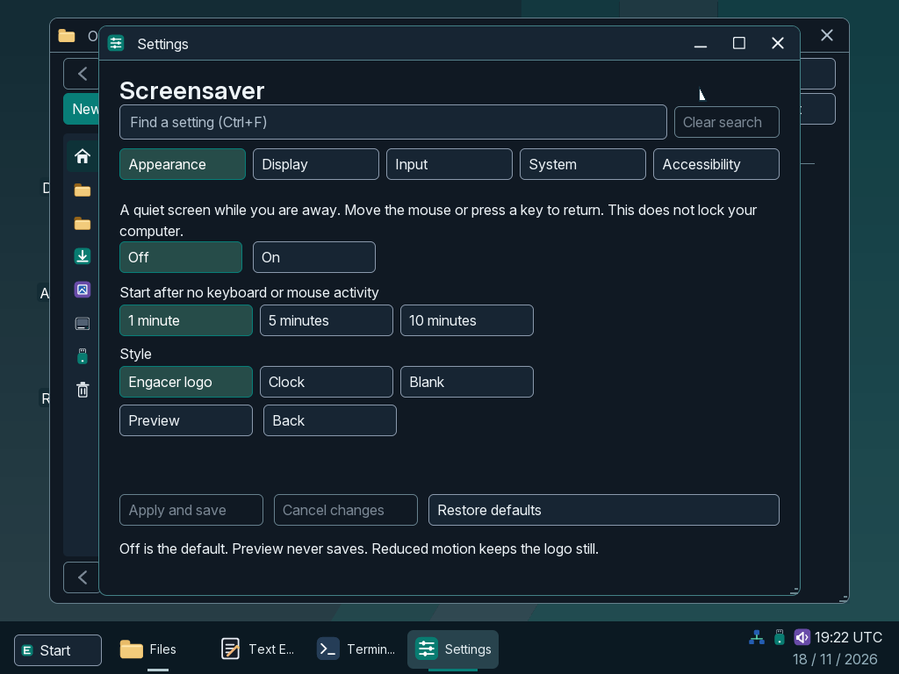

# Make Engacer OS M13.11 yours

Use the matching M13.11 testing release. Exact native functional qualification passes; whole-product integration follows in M13.12 and stability remains exclusively M13.13.

## Choose a comfortable appearance

Open **Start → Settings → Appearance**, or the **Appearance** desktop shortcut. Pick an accent, Light or Dark, a wallpaper and its pattern. The desktop changes immediately so you can inspect it. **Apply and save** keeps the choices. **Cancel preview**, Escape or closing the owning Settings window restores your previous appearance. **Restore defaults** previews this distribution's defaults; it does not restore removed apps or delete files.

Use **Display** for a supported size. A size that leaves too little room is refused before changing the workspace. Use **Accessibility** for High contrast and Reduced motion. These choices save independently from the appearance preview. High contrast uses an explicit Start outline and marks the current Files place with a white edge. Reduced motion removes decorative motion and keeps the screensaver logo still.

## Set up the screensaver

1. In **Settings → Appearance**, choose **Screensaver** beside the heading.
2. Leave **Off** for the ordinary desktop, or choose **On** to start it after inactivity.
3. Choose **1 minute**, **5 minutes** or **10 minutes** without keyboard or mouse activity.
4. Choose **Engacer logo**, **Clock** or **Blank**. The Clock uses the shared UTC clock even if you remove the optional Clock app.
5. Choose **Preview** to see the style. Move the mouse, use the wheel or press a key to return. The first complete wake gesture is consumed so it does not activate a button or type into your document.
6. Choose **Apply and save** to keep the choices. **Cancel changes**, Escape, **Back**, another category or closing this Settings window restores the saved screensaver choices. **Restore defaults** proposes Off, one minute and the logo; Apply keeps those defaults.

Preview never saves or changes your files. It waits until the key or mouse button used to start it is released. Your windows, folder locations and unsaved documents remain in place. A second Settings window explains when another window owns unsaved changes.

The screensaver is a built-in, optional Settings feature, not a separate app to launch or uninstall. Off disables automatic activation. It does not lock your computer or turn off the display. Logo movement updates at most once a second, Clock updates once a minute and Blank has no animation. The existing renderer also handles ordinary shared-service redraws. No extra framebuffer or background app is created.

## If saved choices cannot be used

An unreadable, malformed or unsupported screensaver record activates safe Off defaults. The Screensaver page explains this. Choose **Restore defaults → Apply and save** to replace the invalid record with supported choices. A failed write keeps your draft and offers Apply again or Cancel; it does not claim success.

Screensaver changes and appearance previews have separate saved records. Updating one does not save or reset the other. Finish or cancel an active file operation before saving settings.

## Customize Start and the taskbar

Right-click an app or folder to pin it or change its supported category. **Start → Customize** manages categories, Start pins and taskbar pins. The [Start guide](start-m136.md) explains search, grouping, window switching and restore-default behavior. One click selects a file; double-click or Enter opens it.

## Keep the base independent

Use **Settings → System → Applications** to remove or reinstall supported optional apps from the verified offline cache. Files, Settings, the desktop, shared clock and other required services remain available. Removing Calculator or Clock does not remove the screensaver or change its saved choices. Personal files are kept.

Distribution authors retain the validated schema-3 branding, accent, wallpaper, theme and optional-app selection. Screensaver defaults are Off; there is no extra schema-3 screensaver field. See the [distribution guide](distributions.md). A changed image needs its own qualification.

## Exact preference format

Developer reference: `/System/Settings/screensaver21-<user>.bin` contains five little-endian 32-bit values: magic `0x31325345`, version `1`, enabled `0` or `1`, seconds `60`, `300` or `600`, and style `0` (logo), `1` (Clock) or `2` (Blank). Exactly twenty bytes and a valid native filesystem CRC are required. Unsupported or additional bytes are refused. Settings writes this record through the existing checked filesystem operation; the appearance record remains unchanged.

This guide describes supported behavior, not general hardware, GPU acceleration, human novice-study or stability qualification. Use the [matching release scope](../releases/m1311-v0.13.11.md).
