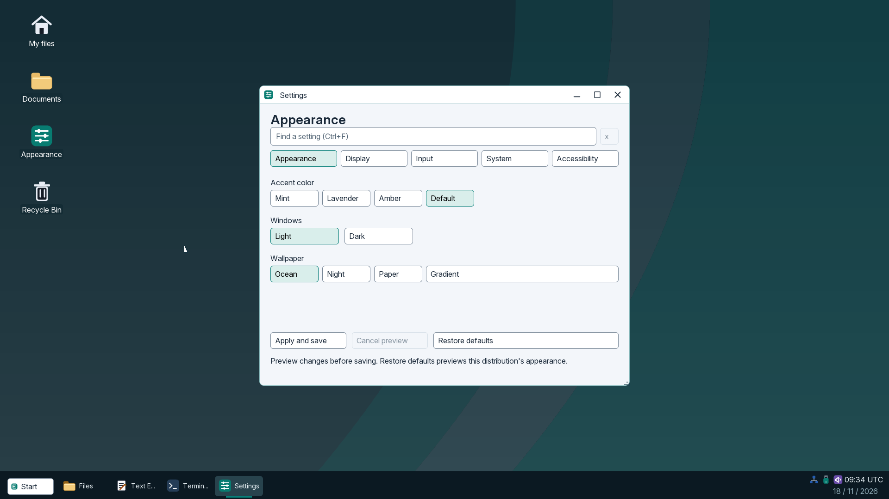
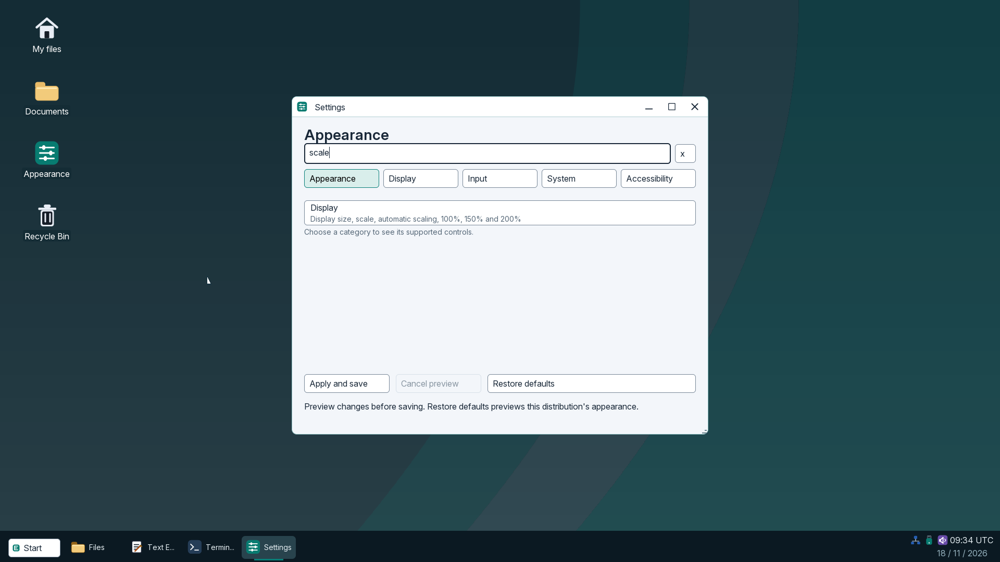
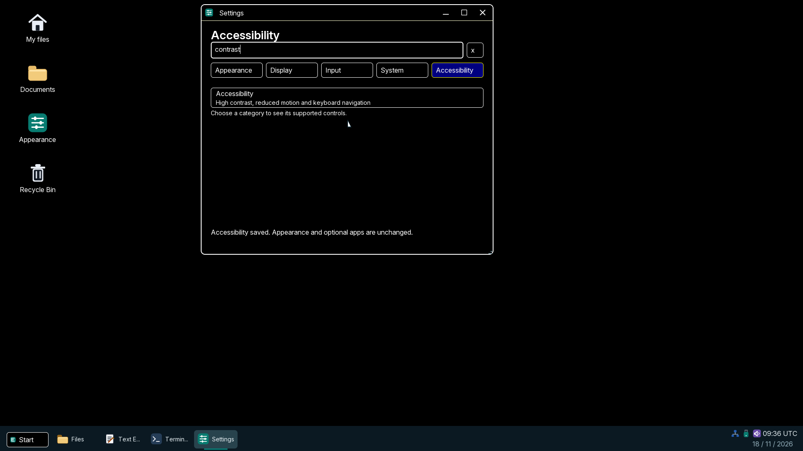

# Find and change settings in Engacer OS M13.8

**Known freezes — testing only:** the owner reports frequent freezes on M13.8. Do not use this build for everyday work. Stability is not qualified. M13.9 addresses the faults; M13.12 covers integration and [M13.13 is the blocking stability release gate](../milestones/m13-13.md).

Use the matching [M13.8 release](../releases/m138-v0.13.8.md) and [installation guide](install-m138.md). Its named native Settings, feedback and display qualification is separate from later M13 integration and hardware work.

## Find a supported setting

Open Settings from Start or Appearance on the desktop. The fixed search row stays above five categories: Appearance, Display, Input, System and Accessibility. Click Find a setting or press Ctrl+F, then type a word such as dark mode, scale, keyboard, apps or contrast. Choose a result, or press Enter to open the first matching category. Results show a short description of the real controls in that category.

The search checks only these supported category names, descriptions and declared aliases. It accepts up to 63 ASCII characters; it does not index files, install a driver or create an unsupported setting. Every live Settings window owns its temporary query. Closing that window or restarting clears it. A search itself never saves preferences.

With no matches, shorten the query or use the x button to clear it. Category tabs also return to the chosen category. Escape clears a nonempty query, then leaves the search field. Only a later Escape cancels an active appearance preview. In a file dialog, Ctrl+F does not take ownership away from that dialog.

## Preview appearance and display size

Choose Appearance, then an accent, Light or Dark, or a wallpaper. The change is a live preview. Apply and save commits your user appearance and normal window sizes. Cancel preview or closing the Settings window restores the previous session appearance without saving it.

Display previews Automatic, 100%, 150% or 200% when the physical screen leaves enough logical workspace. A refused size keeps the previous display and explains how to recover. Windows reflow to stay reachable. Cancel restores the earlier scale. Finish or cancel a file dialog before changing display size.

Restore defaults previews this distribution's appearance. Review it, then Apply to keep it or Cancel to restore your previous choices. It does not erase personal files or reinstall removed applications.

Only one Settings window owns a visual preview at a time. Another Settings window explains the conflict and disables competing changes. Return to the owner and Apply or Cancel before starting a different preview.

## Choices that save immediately

Input labels its immediate-save behavior. Choose the double-click interval or the supported keyboard layout; a click still selects, and a double-click opens. These records remain independent of appearance previews.

Accessibility provides high contrast, reduced motion and Reset accessibility. Those choices also save independently. High contrast overrides the theme while enabled; switching it off restores the theme. Keyboard navigation uses Tab, F6 and the visible focus outline. Screen-reader support is not implied.

## Applications and devices

System opens real Devices, Applications, Start/taskbar and Quick settings surfaces. To remove an optional app, open Software, choose the installed app and review removal. Removing Calculator does not remove Files, Settings, the desktop or your documents. Restore appearance defaults does not reinstall it; use Software to install it again.

Devices reports actually discovered hardware and supported capability. A listed device does not imply a working driver for every function. No general GPU acceleration, Wi-Fi or arbitrary physical hardware compatibility is claimed by this Settings update.

## Recover without losing your work

If another file operation blocks saving appearance, keep the preview and finish or cancel that operation. Show current dialog returns to its actual owning window. A refused save does not claim persistence. An unreadable appearance record activates safe defaults and explains that Apply can save valid choices.

Unsaved editor text stays available when a dialog is cancelled. If a file changed in another window, Save refuses the stale source; use Save as with a new name to preserve your edits. Missing USB drives retain a useful empty view; reconnect and explicitly choose the current drive. Opening it never formats it.

Ordinary shell messages prefer the lower workspace and avoid window captions. Dismiss clears only the message. In crowded arrangements the focused caption remains protected. File-operation notices and confirmation dialogs retain their own owners; dismissing feedback does not cancel or approve a disk operation.

## Actual native views

The [milestone](../milestones/m13-8.md), [acceptance](../../evidence/M13/8/acceptance-results.json) and [resources](../../evidence/M13/8/resources.json) state the tested profiles and limits. Agent scenario review is separate from a human novice study.

## Long sessions under investigation

The owner reported a long-uptime freeze on M13.7. Its duration and cause are not established. M13.9 investigates and corrects it; M13.12 must repeat real-duration qualification. The M13.8 Settings qualification does not claim that this freeze is fixed. The optional screensaver is scheduled for M13.11 and is not a stability workaround.

## Public delivery

The exact twenty GitHub assets, native homepage/recovery Saves and public desktop/mobile search, task navigation, manuals, matching downloads and responsive layouts pass. Fresh reads verify 477 pages, all 306 article source references and 3,364 unique links. The link audit has zero known broken targets and 13 explicitly unverified external HEAD references. [Publication receipt](../../evidence/M13/8/publication-results.json), [fresh readback](../../evidence/M13/8/website-readback.json), [link audit](../../evidence/M13/8/website-links.json).
