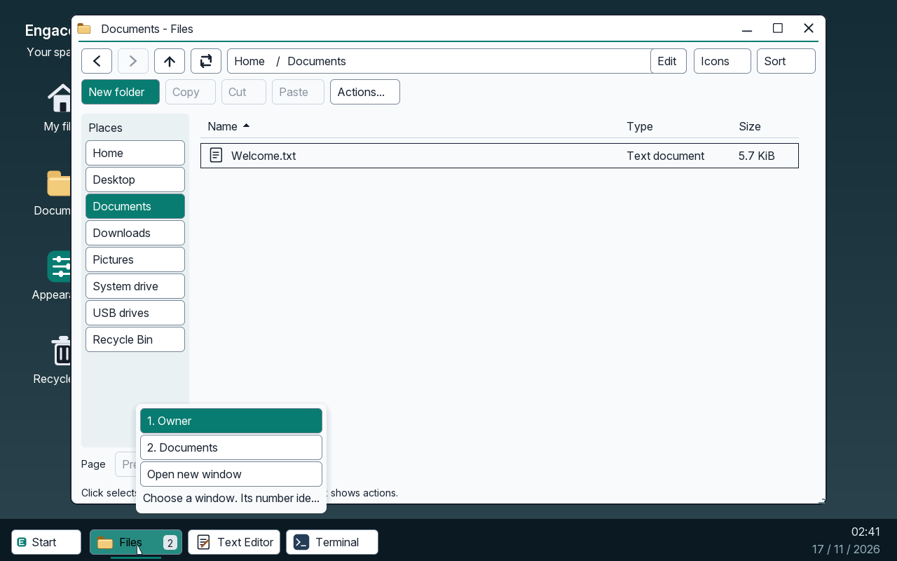

# Engacer OS M12.10 / 0.12.10 - Grouped taskbar

M12-STAGE10-VM-v1 native qualification passes. [Complete public delivery](../../evidence/M12/10/publication-results.json) passes: twenty downloads, 349 pages and 2,405 links, with native homepage Save and actual desktop/mobile verification. The original GitHub release body remains pinned to its source commit.

Build: `3cc55b89594d7e8d0902d44324beb97c`.
ISO SHA256: `ec0a755a44b994460a95e4205136848286cd92ed328f8b036e6a28cb23d62b2f`.
VMware ZIP SHA256: `2780c528681ad511b5a0fca6b8e33ab78618236be9bbc21735b21506d314b404`.

## What changes

One app button now combines its pin and open windows, using the shared original
icon and canonical app identity. Single-window buttons minimize/restore; several
windows open a numbered folder/document chooser. Counts, active indicators and
minimized-only dots distinguish actual state. A hidden active app highlights
More apps. Overflow focuses/restores rather than minimizing the selected app.

Pins retain per-user order and alignment. Unpinned running apps stay reachable;
first-appearance ordering prevents window focus/Z-order changes from moving
buttons. Overflow is bounded and paginated when thirteen hidden apps cannot fit
the twelve-item menu. New-window requests retain the eight-window limit.

Context close keeps dirty-work review and file-dialog owner guards. Unpinning
keeps the app, data and windows. Software Manager refuses removal while an app
is open; after closing it, removal prunes its pin/group and reinstall works.

## How and why

Derive the unique app union from existing pin/window identities, reusing the
window manager, validated version-one preferences and generation tokens. Fixed
shared chooser labels and a small nonpersistent order array avoid dangling label
pointers and moving buttons. There is no per-window preview framebuffer, extra
process or idle animation. [Design decisions](../architecture/taskbar-m1210.md),
[taskbar guide](../handbook/taskbar-m1210.md) and
[eight-step installation](../handbook/install-m1210.md).

## Verification

[Exact-source acceptance](../../evidence/M12/10/acceptance-results.json) records
590 compiled Git inputs; actual keyboard/mouse group launch, minimize/restore,
window choice, dirty close, owner protection, pin ordering/removal, in-use refusal,
package removal/reinstall, eight-window overflow and ordinary installed starts.
Compact light/dark, 150% and actual 3840x2160/200% cover real menus and review.
The compact maximum case uses eight pins plus eight distinct running apps and
reaches the second overflow page. Host production union/order/layout checks
cover 295907 assertions. The actual decoder passes 553 pages and 10808
malformed/fuzz cases with unchanged guard bytes. Separate matching VMware/BIOS
installation, twelve cached/full movement comparisons and actual compressed
boot repair pass for these exact bytes.

[Resources](../../evidence/M12/10/resources.json) distinguish fixed state, peak
and retained pages. Compiled fixed shell state is 552925 bytes, 840 above M12.9.
Shared font bytes stay unchanged; no raster/preview cache or new worker is
introduced. Configured guest RAM is not measured OS consumption.

## Scope and retained limits

- Grouping covers native catalogue identities and retains the eight-window quota.
- Window switcher/snap refinements follow separately in M12.11.
- M12.14 retains shared menu/footer/conflict and Start query/notice feedback,
  plus background transfer/file-dialog arbitration. Finish/cancel transfers
  before opening a picker until that integration gate is qualified.
- M12.16 retains cursor isolation and small-mode versus explicit scale limits.
- The earlier concurrent BIOS/AHCI observation and complete final controller/
  original-app matrix remain M12.18; this stage does not establish stress reliability.
- Physical/ARM, vendor GPU 3D and universal Windows compatibility remain unqualified.
- Agent visual/scenario checks are not a human usability study. GitHub downloads
  and complete public website proof close separately before M12.11.

