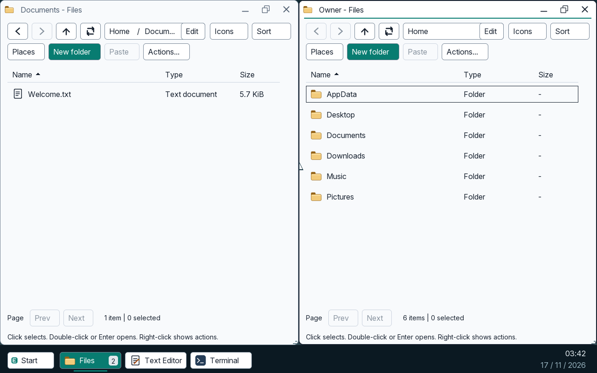

# Engacer OS M12.11 / 0.12.11 - Native multitasking

M12-STAGE11-VM-v1 native qualification passes for these exact bytes. This is a scoped desktop delivery; complete public publication proof is tracked separately in the handbook.

Build: `72213fbfbc4e2bb33001b0a8b12ace54`.
ISO SHA256: `b94625c0f0870cd6df29ef6ee4f75e7c58f79e2ecd029acab1550a9b7e043373`.
VMware ZIP SHA256: `c8fd4e476f352a2080d506f3e6ca46fd5ff8906d053a9f0b1d1015aa806f99f9`.

## What changes

Alt+Tab shows original icons and numbered document/folder identities, including
minimized and unsaved state. Arrows, Tab and Shift+Tab choose within a bounded
MRU snapshot. Alt release, Enter or the mouse commit; Escape preserves focus.

The window menu adds Arrange windows with previewed Left half, Right half,
Maximize and Cancel choices. Supported half placement offers another actual
window for the other side, or the choice to leave it unchanged. Existing edge
drag and Windows+arrows share this assistance. Each window restores its own
normal bounds. Compact unsupported halves are disabled with a useful reason.

File-dialog owners cannot be rearranged and are excluded from complementary
choices. Switching and arranging retain unsaved work. The eight-window quota
and existing provider limits remain.

## How and why

Reuse generation-scoped geometry and the existing eight-token array, adding an
owner token and side value. There is no thumbnail framebuffer, extra process,
worker or idle animation. Fixed shell state grows by 32 bytes to 552,957.
[Design decisions](../architecture/multitasking-m1211.md),
[window switching and layouts](../handbook/multitasking-m1211.md) and
[eight-step installation](../handbook/install-m1211.md).

## Verification

[Exact-source acceptance](../../evidence/M12/11/acceptance-results.json) binds
591 compiled inputs and eleven native task/profile checks to actual native install/switch/arrange/drag/cancel, dirty
work, modal-owner protection, minimum refusal, quota and independent disk starts.
Compact light/dark, actual 150% and physical 3840x2160/200% qualify the real
controls. Enabled-device VMware, separate BIOS, twelve movement comparisons
and real compressed boot repair pass for these exact bytes.
The actual C decoder passes 556 round-trip pages and 10,808 malformed/fuzz cases
with unchanged guard bytes and no heap allocation.

[Resources](../../evidence/M12/11/resources.json) distinguish fixed, peak and
retained pages; configured guest RAM is not measured OS consumption.

## Scope and retained limits

- Eight real windows; supported halves and maximize, no thumbnail caches,
  arbitrary quarter layouts or virtual desktop expansion.
- M12.14 retains shared-menu footer/conflict and Start query/notice feedback,
  new-versus-saved Editor status and background transfer/file-dialog arbitration.
  Finish/cancel transfers before opening a picker until that gate is qualified.
- M12.16 retains cursor isolation and compact-startup versus explicit scale limits.
- M12.18 retains the earlier concurrent BIOS/AHCI observation and complete final
  controller/original-app matrix. Stress reliability is not established here.
- Physical/ARM, vendor GPU 3D and universal Windows compatibility remain unqualified.
- Agent review is not a human study. Public release and complete website proof
  close separately before M12.12.

## Complete public delivery

[Publication proof](../../evidence/M12/11/publication-results.json) passes: twenty matching downloads, 357 pages and 2,457 links, native homepage Save and actual desktop/mobile guide/download verification. The original GitHub release body remains pinned to its source commit. M12.12 follows in order.
