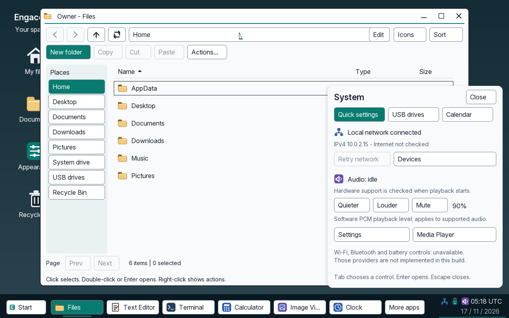

# Engacer OS M12.12 / 0.12.12 - System tray and quick settings

M12-STAGE12-VM-v1 native qualification passes for these exact bytes. Complete public publication proof closes separately before the next stage.

Build: `93839018f852f6b6ba79643004d5f101`.
ISO SHA256: `c25247ddc6d38194bd809dae0fe905409056fc45f60946c3c306b0a1c5a4b857`.
VMware ZIP SHA256: `274f65cecc047af9a47b141b88737085ff33547935ba6841bba263e8767bce0b`.

## What changes

Windows+A opens one bounded native panel with Quick settings, USB drives and
Calendar. Wider taskbars show network, USB and audio entries beside the real
UTC date/time; compact taskbars retain a reachable System button.

Network state and retry admission follow the real provider. PCM level/mute
controls the actual software gain and saves for restart when storage is free.
During file work it explains a session-only change. USB Open uses common Files;
safe removal checks the actual flush result and refuses during a transfer.
Generation-bound controls prevent a held click from targeting a replacement.
The real UTC calendar opens the optional Calendar only by explicit choice.
Removing Clock, Calendar or Media Player leaves the base services intact.

## How and why

Reuse shared controls, original icons and existing kernel providers. There is
no extra app slot, worker, pixel cache or idle scanner. Fixed shell state grows
by 239 bytes to 553,196. [Architecture](../architecture/tray-m1212.md),
[system tray guide](../handbook/tray-m1212.md) and
[eight-step installation](../handbook/install-m1212.md).

## Verification

[Exact-source acceptance](../../evidence/M12/12/acceptance-results.json) binds
593 compiled inputs and 11 native task/profile checks to real installation,
USB/PS2 independent startup, exact saved preferences, local DHCP/link/retry,
unavailable playback, optional-app removal/reinstallation, late USB replacement
and a real 64-MiB transfer/cancel/removal guard. Source USB images are unchanged.
Four real display profiles include compact light/dark and physical 4K/200%.
Exact enabled-device VMware, separate BIOS, twelve movement comparisons and
actual compressed boot repair pass. The production decoder passes 559 round-trip
pages and 10,808 malformed/fuzz cases with unchanged guards and no heap allocation;
production taskbar arithmetic passes 295,907 host assertions.

[Resources](../../evidence/M12/12/resources.json) distinguish initial hardware,
fixed state, peak and completed UI retention. Configured guest RAM is not
measured kernel consumption. [Development observations](../../evidence/M12/12/diagnostics/README.md)
retain failed harness observations separately from the final passes.

## Scope and retained limits

- A local IPv4 address is not proof of Internet access. PCM gain is not a
  universal hardware master mixer. Wi-Fi, Bluetooth and battery providers are unavailable.
- Calendar uses UTC and bounded 2000–2099 navigation; no timezone/DST/NTP claim.
- Existing filesystem/device, eight-window and create-only USB export limits remain.
- M12.14 retains feedback/modal arbitration; M12.16 retains scale/cursor work,
  M12.17 renderer work and M12.18 the BIOS/AHCI observation and complete final
  controller/original-app matrix. Physical/ARM, vendor GPU 3D and universal
  Windows compatibility remain unqualified.
- Agent visual review is not a human study. Public release and full website
  verification close separately before M12.13.

## Complete public delivery

[Publication proof](../../evidence/M12/12/publication-results.json) passes: twenty matching downloads, 364 pages and 2,513 HTTP links, native homepage Save and actual desktop/mobile guide/download verification. The original GitHub release body remains pinned to its source commit. The separate platform email-sharing observation is retained for M12.18; the normal HTTP crawl does not exercise email composition. M12.13 follows in order.
