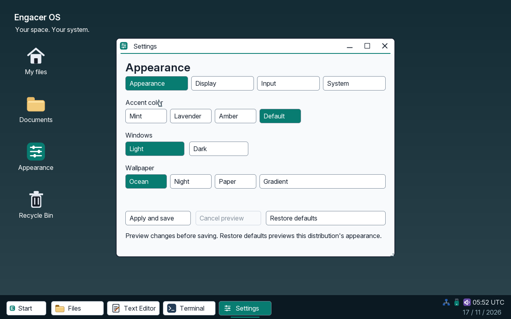

# Engacer OS M12.13 / 0.12.13 - Settings and personalization

M12-STAGE13-VM-v1 native qualification passes for these exact bytes. Complete public publication proof closes separately before the next stage.

Build: `119eb7a0e54f4914b768c6d31cf3d01c`.
ISO SHA256: `47034f41b0880984018aa67d46265d3af069b7c57120625273ec461fef811efb`.
VMware ZIP SHA256: `539b0418881070d2e74071870f8f82b34268ff76850fefe84ecd35ee3dfbab29`.

## What changes

Settings offers Appearance, Display, Input and System with shared selected
controls and readable feedback. Colors, wallpaper, pattern and display size
have a real preview. Apply and save persists it; Cancel, Escape or closing its
owner restores the previous session appearance without writing settings.
Another Settings window cannot overwrite the preview. Distribution defaults
are previewed before explicit Apply and do not reinstall removed apps or change
files, pins or independent input preferences.

Input offers explicit 200/500/900-ms intervals and US QWERTY/Dvorak choices,
clearly saved when clicked. System opens the real Devices, Applications,
Start/taskbar and Quick settings. Devices Back remembers the System category.
Malformed saved appearance falls back safely and explains how Apply repairs it.

## How and why

One generation-scoped owner stores five original visual values, eight category
bytes and a validation flag. No new preference ABI, application slot, worker,
pixel snapshot or idle scanner is needed. Fixed shell state grows by 32 bytes
to 553,228. [Architecture](../architecture/settings-m1213.md),
[Settings guide](../handbook/settings-m1213.md) and
[eight-step installation](../handbook/install-m1213.md).

## Verification

[Exact-source acceptance](../../evidence/M12/13/acceptance-results.json) binds
595 compiled inputs and 9 native task/profile checks to real install,
disk-identical Cancel/close, Apply bytes, competing previews, protected unsaved
work, independent optional-app removal, input persistence and ordinary USB/PS2
startup. A semantically malformed record has independently valid filesystem
CRCs: the real loader refuses it, Settings repairs it and ordinary startup
loads the exact valid replacement while preserving personal content.

Four actual display profiles include compact light/dark and physical 4K/200%.
The real 150% preview cannot close/change scale across another file-dialog owner.
Exact enabled-device VMware, separate BIOS, twelve movement comparisons and
compressed boot repair pass. The production decoder passes 562 round-trip pages
and 10,808 malformed/fuzz cases with unchanged guards and no heap allocation;
production taskbar arithmetic passes 295,907 host assertions.

[Resources](../../evidence/M12/13/resources.json) separate fixed, peak and
completed retention; configured guest RAM is not measured OS consumption.

## Scope and retained limits

- Visual preferences use explicit preview Apply/Cancel. Input choices save
  independently when clicked. Existing on-disk preference formats remain.
- Display changes reflow windows for reachability; independent window
  arrangements are not rolled back. Existing explicit-size limits remain for M12.16.
- Active file operations/dialogs and Windows jobs guard preference writes.
  M12.14 retains broader feedback and background transfer/modal arbitration.
- M12.16 retains cursor/scale work; M12.17 renderer work; M12.18 the earlier
  BIOS/AHCI observation, complete final controller/original-app matrix and
  the separate website custom-domain email-sharing observation.
- Physical/ARM, vendor GPU 3D and universal Windows compatibility remain unqualified.
- Agent visual review is not a human study. Public release and full website
  verification close separately before M12.14.

