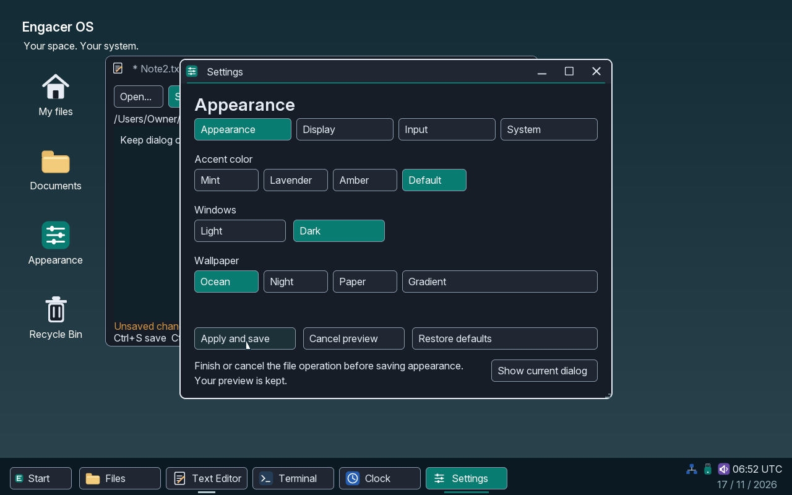

# Engacer OS M12.14 / 0.12.14 - Feedback and errors

M12-STAGE14-VM-v1 native qualification passes for these exact bytes. Complete public publication proof closes separately before M12.15.

Build: `2587bc314f61f7e9f5b61ba3f884c95d`.
ISO SHA256: `7ba6267998e12f5b14f819e58e41efe7ba8d317e891b739ed6796c38a790381f`.
VMware ZIP SHA256: `0f8fae6023845adfd49cf052e685b20ee954c913b29d52adf6f38ac3dfe5a60e`.

## What changes

Shared file menus display a complete two-line explanation. Start makes its global app/folder search scope explicit and offers Clear search without changing browsing preferences. New empty documents no longer claim to have been saved. Malformed Settings instructions describe saving your choices, and System has contextual help.

Global messages use a bounded dismissible card that owns its click region and leaves Files footers intact. File errors remain with their source window. Settings offers Show current dialog when another valid review blocks persistence. The real generation owner is restored without accepting or cancelling its review.

Active transfers and Windows jobs refuse new common pickers, file review dialogs and Editor saves before changing owners or publishing data. Existing dialogs already refuse competing transfers. Unsaved text is retained. Keep both, Cancel and missing-source errors retain truthful outcomes.

## How and why

Existing bounded buffers, owners and file-operation state are reused. Fixed shell state remains 553,228 bytes (0 added), and the licensed shared font is unchanged. There is no new app slot, background worker, retained notification surface or idle polling timer.
[Architecture](../architecture/feedback-m1214.md), [messages guide](../handbook/feedback-m1214.md) and [eight-step installation](../handbook/install-m1214.md).

## Verification

[Exact-source acceptance](../../evidence/M12/14/acceptance-results.json) binds 596 compiled inputs and 13 native task/profile checks to actual saved/absent file bytes, changed-file Save refusal, conflict ownership, global-search controls, notification bounds/click isolation, missing USB, a real 64-MiB cancelled copy, removed-source failure and independent no-ISO USB/PS2 startup.

Four real display profiles cover compact light/dark, actual 150% and physical 4K. Exact enabled-device VMware installation and two independent boots, separate BIOS startup, twelve cached/full movement comparisons and actual compressed boot repair pass. The production decoder passes 562 round-trip pages and 10,808 malformed/fuzz cases; production taskbar bounds pass 295,907 assertions.
[Resources](../../evidence/M12/14/resources.json) separate fixed state, peak and completed retention; configured guest RAM is not measured OS consumption. Agent visual review is not a human usability study.

## Scope and retained limits

- Named virtual profiles only. Physical/ARM, vendor GPU 3D and universal Windows compatibility remain unqualified.
- Existing native filesystem, removable-media and foreign-application ABI limits remain.
- M12.15 covers setup/first use; M12.16 cursor/scale/accessibility; M12.17 renderer performance.
- M12.18 reruns the final controller/original-app matrix and the earlier BIOS/AHCI concurrency and website email-sharing observations. Historical failures remain recorded.
- Public release and complete website verification close separately before the next stage.

## Complete public delivery

[Publication proof](../../evidence/M12/14/publication-results.json) passes: twenty matching downloads, 375 pages and 2,617 HTTP links, native homepage Save and fresh desktop/mobile/manual/download/search verification. The public release body and media remain pinned to their qualified source. M12.15 follows in order.
