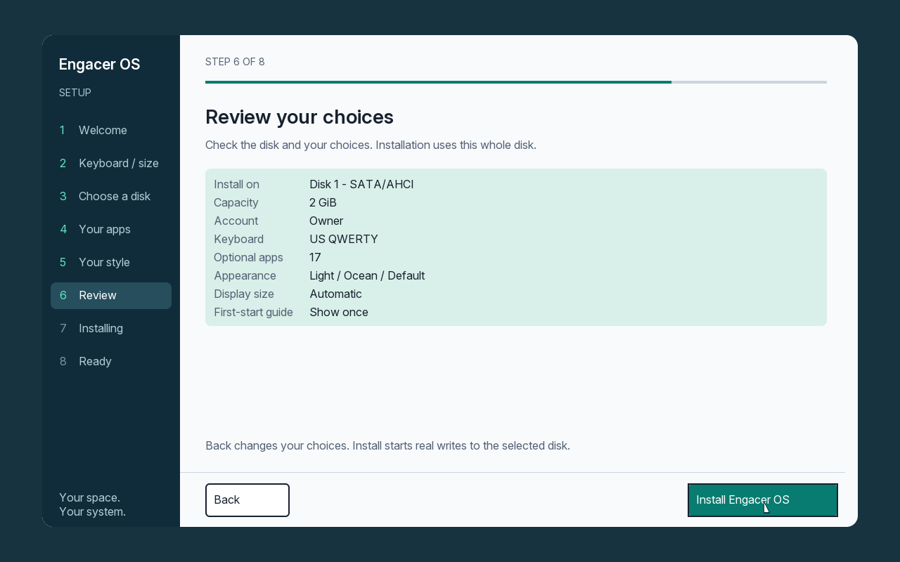

# Engacer OS M12.15 / 0.12.15 — Setup and first use

M12-STAGE15-VM-v1 native qualification passes for these exact bytes. Complete public delivery closes separately before M12.16.

Build: `3132ae8bdbb08538362744d434153186`.
ISO SHA256: `a6271c3d42232481608ace866ef39d0bfed888e2621faef9785d45ffe1a983e6`.
VMware ZIP SHA256: `3d782e44497dd6dc59cc2139e0c311e8f84710e4a6383562af0972060204d5c3`.

## What changes

The real native eight-step wizard shares readable typography, controls and original app icons with the desktop. Compact 800×600 keeps all ordinary choices; larger screens add previews. Next preserves the outer frame. Review lists the actual choices before writes; whole-disk replacement retains separate fresh consent.

The first-start guide follows the saved theme and uses required Files, Start and Settings. Application management now belongs to required Settings rather than depending on the optional Software launcher. The offline quickstart uses current controls and provider limits.

## How and why

Existing setup options, action IDs, controller checks and disk backends stay bounded. Shared palette luminance selects readable accent text. No new app slot, background worker, retained framebuffer or idle scanner is introduced. Fixed shell state is 553,228 bytes (+0 from M12.14); shared font bytes are unchanged. [Architecture](../architecture/setup-m1215.md), [setup guide](../handbook/setup-m1215.md), [installation](../handbook/install-m1215.md).

## Verification

[Exact-source acceptance](../../evidence/M12/15/acceptance-results.json) binds 597 compiled inputs and 17 native task/profile checks to actual eight-step installs, pre-install disk hashes, Back, hit bounds, partition create/delete/format, unselected-disk preservation, write failure/quarantine/retry, recovery, custom account, minimal apps, base guide and independent no-ISO USB/PS2 boots.

Actual ordinary, compact, explicit 150% and physical 4K/200% installs, exact enabled-device VMware, separate BIOS startup, twelve cached/full movement comparisons and compressed boot repair pass. The production decoder passes 560 round-trip pages and 10,808 malformed/fuzz cases; taskbar bounds pass 295,907 assertions. [Resources](../../evidence/M12/15/resources.json) separate fixed state, peak and retention. Agent review is not a human usability study.

## Scope

Advanced partition tools still require logical 1024×768; the ordinary wizard fits 800×600. Installation replaces the reviewed whole disk, with no dual-boot or partition resizing. Named virtual profiles only; physical/ARM, universal hardware, vendor GPU 3D and expanded Windows support remain unqualified. M12.16 handles accessibility/cursor/scale, M12.17 performance and M12.18 the final controller/original-app matrix and retained observations. Earlier candidate failures remain diagnostics.

