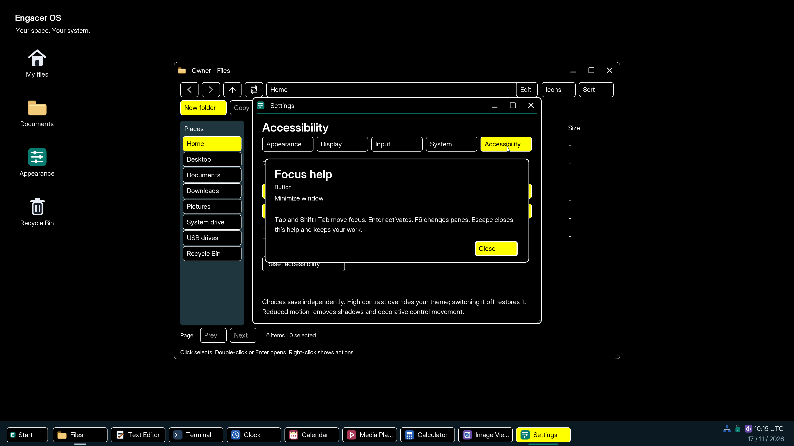

# Engacer OS M12.16 / 0.12.16 — Keyboard and accessibility

M12-STAGE16-VM-v1 native qualification passes for these exact bytes. Complete public delivery passes: twenty downloads, 395 pages and 2,749 HTTP links, with native Save and desktop/mobile/manual/search/archive readback. M12.17 follows in order.

Build: `931575f2d9d3cbfc2038125c394f7589`.
ISO SHA256: `15b0ab8d350d7c157f150bb21c81dbc01bd12eab3d77fa57ff7d885eae34578a`.
VMware ZIP SHA256: `9b14bab653ab8478876174349d68626915d0a0c6f7607346d61e48c245a394cf`.

## What changes

Settings adds Accessibility: independent high contrast and reduced effects. Tab/Shift+Tab and Enter/Space expose visible native focus. F6/Shift+F6 moves among available window, taskbar, desktop and notification panes. F1 describes the actual focused control and preserves the underlying dialog or unsaved document. Original USB HID and PS/2 providers handle the same keys.

Supported display previews now use the ordinary desktop logical 800×600 minimum. Physical cursor hotspots reach every screen edge without shifting to fit the whole arrow. Real 150% and 4K/200% tests compare physical VRAM, compositor shadow, input and actual scaled clicks.

## How and why

Two bounded semantic records and four state words avoid per-control label allocations. The existing appearance ABI stays unchanged; accessibility saves a separately validated 16-byte per-user record. Invalid length/magic/version/flags/reserved data uses safe defaults and is not silently rewritten. Reduced effects removes decorative shadows, hover washes and pressed icon/text movement. No new app slot, background worker, framebuffer cache or idle scanner is introduced. Fixed shell state is 553,452 bytes (+224 from M12.15), including alignment and clipped-cursor fallback state; shared fonts are unchanged.

[Architecture](../architecture/accessibility-m1216.md), [keyboard guide](../handbook/accessibility-m1216.md), [installation](../handbook/install-m1216.md).

## Verification

[Exact-source acceptance](../../evidence/M12/16/acceptance-results.json) binds 599 compiled inputs and 12 native task/profile checks to keyboard-only installation and desktop tasks, independent USB/PS2 startups, five actual Light/Dark/high-contrast scale profiles, held-input pixel comparisons, modal/generation/eight-window ownership, six independently filesystem-CRC-valid malformed record cases, valid reset and no silent writes.

Exact enabled-device VMware, separate BIOS startup, twelve cached/full movement comparisons and actual compressed boot repair pass. Production palette tests cover all 16,777,216 accent foregrounds and 1,572,864 component states; decoder/taskbar bounds remain separately checked. [Resources](../../evidence/M12/16/resources.json) separate fixed state, peak and retention. Automated review is not a participant usability study.

## Scope

Native Focus Help is a visual semantic consumer, not an external screen-reader or speech protocol. Native shadow-framebuffer cursor profiles are tested; the guarded direct-framebuffer fallback is compile-qualified separately. Named virtual profiles only: physical/ARM, universal hardware, vendor GPU 3D and expanded Windows support remain unqualified. Advanced partition tools retain logical 1024×768. M12.17 handles rendering performance; M12.18 retains the final controller/original-app matrix and site-sharing observation. Earlier candidate failures remain diagnostics.

