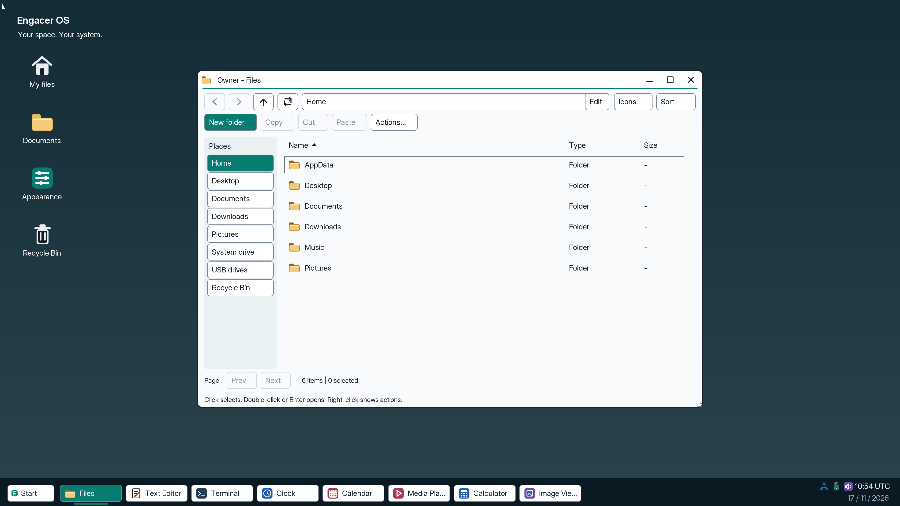

# Engacer OS M12.17 / 0.12.17 — Motion and performance

M12-STAGE17-VM-v1 native qualification passes for these exact bytes. Complete public delivery closes separately before M12.18.

Build: `cc3562fe59b46e079ec4ca287fec75bb`.
ISO SHA256: `7411f86eceb4155f6f95020481e2e4a96e69211ae16746aac8846cebb5edd2bd`.
VMware ZIP SHA256: `daa2fdfcc2878bfb66ecda938e51e0a83b37a847fdef24d0741700a35e910487`.

## What changes

Rounded translucent shadow layers jump across the interior pixels that are deliberately covered by the opaque window. The same antialias samples and alpha arithmetic remain at both edges. Current clipping, dirty bounds and row-level audio pumping stay intact. Opaque rendering and legacy non-M12 iteration behavior are preserved.

Window/control feedback stays immediate. Escape cancels an in-progress move and restores the original rectangle. Reduced effects keeps its independently saved choice; no timed animation engine, permanent per-window image, extra worker, cache or idle scanner is added. Fixed shell state stays 553,452 bytes (+0 from M12.16), with unchanged shared fonts. [Architecture](../architecture/performance-m1217.md), [guide](../handbook/performance-m1217.md), [installation](../handbook/install-m1217.md).

## How and why

The production raster had an intentionally unpainted shadow interior, but still visited each covered pixel. A bounded local span jump removes that unnecessary iteration without changing visible output or allocating memory. It is capped by the clipped right edge and preserves the existing row/audio cadence.

The host probe compiles the exact immutable M12.16 and current raster bodies, rather than another raster model. 3,073 signed/clipped/scale/alpha cases preserve exact pixels, blend calls, guard bytes, dirty bounds and audio pumps. In the actual 4K-sized shadow test, visits drop from 25,404,864 to 1,896,768 (92.5% fewer). Recorded host CPU times are 49.0 ms and 9.0 ms for that isolated routine. These measurements are not native FPS or an overall desktop speed claim; the bounded host probe buffers are not OS runtime allocations.

## Verification

[Exact-source acceptance](../../evidence/M12/17/acceptance-results.json) binds 599 compiled inputs and 16 native task/profile checks. Real keyboard-only installation, USB/PS2 starts, five Light/Dark/contrast display profiles, independent settings, malformed-record refusal/reset, modal/generation/eight-window ownership, actual held-input pixels and Dark first use pass again for the new bytes.

A separate default-effects fixture exercises ordinary shadows. Shift+F6 reverses the actual pane route. Escape-cancelled drags at 100%, 150% and physical 4K/200% restore exact bounds and viewport pixels; twelve cached/full default-effects movement comparisons include partially off-screen windows. Exact enabled-device VMware installation and two independent starts, separate BIOS installation/two starts, production decoder/taskbar bounds and actual compressed boot repair pass. [Resources](../../evidence/M12/17/resources.json) separate fixed state, managed current/peak and zero completed retention. All CPUs halt at idle; host-observed event completion includes observation overhead and is not display refresh.

## Scope

Agent review is not a participant usability study. No external screen reader, vendor GPU 3D, universal/physical/ARM hardware or expanded Windows application support is introduced. Advanced partition tools retain logical 1024×768. M12.18 retains the final named-controller and original-app matrix, earlier BIOS concurrency observation, custom-domain email-sharing observation and high-contrast picker/notification boundary polish. Earlier releases and candidate diagnostics remain immutable.

