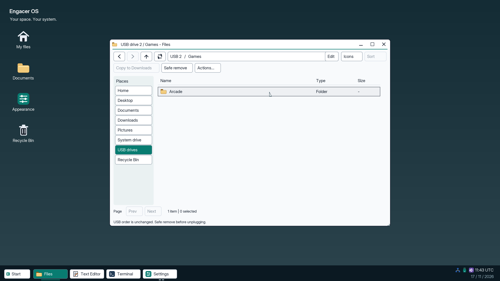

# Engacer OS M12.18 / 0.12.18 — Final desktop qualification

M12-STAGE18-VM-v1 native qualification passes for these exact media.
This release freezes the final named-VM M12 desktop/setup regression;
complete public delivery passes: twenty downloads, 406 pages and 2,853 HTTP links, native homepage Save and desktop/mobile/manual/download/search/archive checks. [Public receipt](../../evidence/M12/18/publication-results.json). All M12.0–M12.18 stages are complete.

Build: `8ee102351039d96f68637a9edbff597b`.
ISO SHA256: `f63b78973c9da269b4eead46873d947e94fcd2266dff4b4c06f2666b743aa3f9`.
VMware ZIP SHA256: `dafd107340e11ea74898c4c7ffab45dc4e31b50856421076e0b2f4787ee5bed4`.

## What is delivered

A real eight-step graphical installation and native desktop with original icons,
single-selection/double-open, common folder navigation, reviewed file operations,
shared dialogs, local Start search/pins/categories, grouped taskbar and window
switching/snap/restore. Base tray/providers, Settings and accessibility remain
independent of removable optional apps. High-contrast picker/notification edges
now have contrasting outlines without adding fixed state or a new worker.

[Install](../handbook/install-m1218.md), [final guide](../handbook/final-m1218.md),
[how and why](../architecture/final-m1218.md),
[acceptance](../../evidence/M12/18/acceptance-results.json),
[resources](../../evidence/M12/18/resources.json).

## Fresh qualification

599 compiled inputs and 184 native task/profile checks match the exact ISO/ZIP.
Fourteen enabled-device VMware profiles cover SATA, IDE, LSI Logic, LSI SAS 1068,
PVSCSI and NVMe with BIOS/UEFI, BusLogic with BIOS, and the exact SATA/UEFI starter.
Each installs, resets with media retained, and boots twice without the ISO or
forced firmware order. The original supported 7-Zip console MSI lifecycle
installs/runs/archives/extracts/removes/reinstalls, with 106 original payload hashes
and independent archive/document comparison.

Real setup/partition consent/failure/retry/recovery, minimal apps, desktop/files/
transfers/dialogs, Start/taskbar/multitasking/tray, Settings/accessibility and
independent USB/PS2 startup pass. Compact, 150% and actual 3840×2160/200% frames
are separate native captures. Named USB/keyboard/hub/low-memory/larger-cluster
round trips and real malformed/read-only/I/O/quota refusals pass their scoped gates.

Twelve new BIOS/AHCI installs in three batches of four concurrent guests and
24 independent disk-only starts pass with distinct images and exact stored guide
bytes. The older M12.2 observation remains historical; its trigger is not claimed
identified and this repeat cannot prove universal reliability.

Fixed shell state stays 553,452 bytes (+0), with unchanged fonts and zero completed
managed-page retention. Twelve default-effect cached/full comparisons and three
Escape-cancelled move profiles restore exact native pixels. The carried production
raster is equivalent in 3,073 host cases. Host timings are not FPS or physical-device
benchmarks. All CPUs halt at idle in the named native tasks.

## Limits and website

The 64-MiB QEMU UEFI topology with USB storage attached before firmware boot remains
an explicit loader refusal; the late-attachment low-memory profile passes. Public
unsigned media keep Secure Boot off. Advanced partition tools retain logical
1024×768. No physical/ARM/universal hardware, vendor GPU 3D, general Windows
installer support, external screen-reader protocol or human usability-study result
is introduced. Earlier stages do not qualify these new bytes.

The owned Brix recovery page uses Engacer OS and canonical documentation/download/
GitHub links; actual hydrated email sharing uses the custom domain. No shared
BrixCanvas platform deployment is required. Final public readback checks the native
homepage Save, manuals, downloads, search, mobile, archives and HTTP links.

