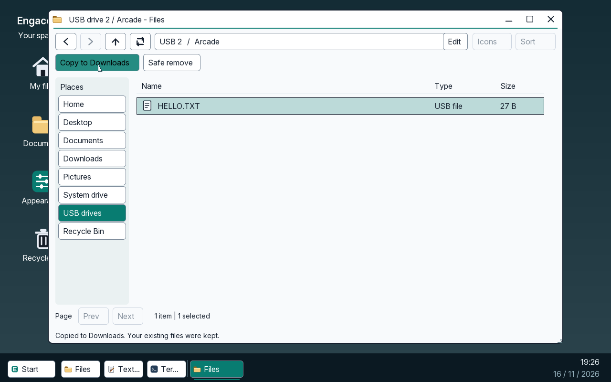

# Engacer OS M12.5 / 0.12.5 — one Files environment

Native qualification passes **M12-STAGE5-VM-v1**.
[Exact-source acceptance](../../evidence/M12/5/acceptance-results.json) verifies
579 compiled Git inputs, ten native journeys, compact light/dark, twelve
cached/full comparisons and matching VMware/BIOS install and independent starts.
Public release and full website proof close separately before M12.6.

Build: `69b114d97561bfe742ac9097748ad3d5`.
ISO SHA256: `36823e017ce466e0df39bcee5ad50b53eaa096f08ccaf4fb27165bac4a680fd7`.
VMware ZIP SHA256: `27c9ae2fd336f5381e8972c36076c96053c09ccc8f0b886abaf5bff87e696b38`.

## What changes

Ordinary folders, the USB drive collection, USB folders and unavailable locations
share one frame. Back, Forward, Up, Refresh, address and Places remain in the same
positions. Titles describe the actual provider. A narrow window replaces the
sidebar with Places rather than hiding basic navigation. The Page controls are
separate from location history. Empty-state content fits short windows too.

Each window keeps eight bounded location records including its provider, full
path, item offset and USB generation-backed identity. Back does not mount a new
device behind the user's back. A removed or replaced drive keeps its old location
unavailable; choosing the connected drive explicitly opens its current contents.
Ctrl+N copies the real current location into an independent window.

Drive objects select on one click and open on double-click or Enter. Ordinary
USB folders retain their actual FAT32 browsing and one-file create-only transfer
capabilities. Shared presentation does not invent unsupported filesystem actions.
Optional USB addresses fit the full existing path without truncating its prefix.
Invalid input keeps the previous location and remains editable for correction.

[Architecture and decisions](../architecture/files-m125.md),
[Files guide](../handbook/files-m125.md),
[eight-step installation](../handbook/install-m125.md).

## Qualification boundary

The stage requires matching source/media, real setup and installed startup,
ordinary independent disk boots, its exact enabled-device VMware ZIP, separate
BIOS journeys, actual 150%/4K frames, detach/replacement and independent stored
bytes. Host history rules supplement these native observations. Managed pages,
linked fixed state and configured guest RAM are separate measurements.

The first complete candidate exposed root-breadcrumb/Refresh dispatch into an
older generic application handler. Its honest failure is retained. The corrected
media repeated and passed its native and boot qualification before public closure.

File presentation, commands, dialogs and the other ordered desktop stages remain
separate. The shared-menu footer fitting and HiDPI cursor-versus-hit observation
remain M12.14/M12.16 follow-ups. The earlier concurrent BIOS/AHCI timeout remains
open for M12.18; stress reliability is unqualified. Physical hardware, ARM,
vendor GPU 3D and universal DOS/Windows compatibility are outside this stage.
Agent visual/scenario review is not a human usability study.

Fixed shell state is **545,620 bytes**, **1,408 bytes** above M12.4 and
**1,792 bytes** above M11.6. History/address storage accounts for that increase.
Tasks retain zero managed pages and no new allocation failures; idle CPUs halt.
The native main journey returns to 4,288,512 managed bytes after physical USB
detach. Framebuffer and device pages are measured separately. Font coverage
remains 251,248 bytes; icon raster cache is zero. [Resources](../../evidence/M12/5/resources.json).

