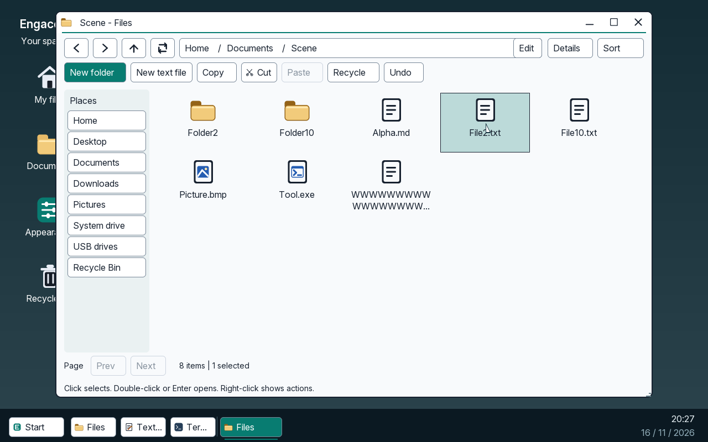

# Engacer OS M12.6 / 0.12.6 — Files presentation

Native qualification passes **M12-STAGE6-VM-v1**.
[Exact-source acceptance](../../evidence/M12/6/acceptance-results.json) verifies
581 compiled Git inputs, ten native journeys, separate actual 150%/4K name-tip
profiles, twelve cached/full comparisons and matching VMware/BIOS install and
ordinary starts. [Public release and full website proof](../../evidence/M12/6/publication-results.json)
subsequently passed before M12.7: twenty assets, 325 pages and 2,244 links. The
original GitHub release notes and accepted media remain pinned and unchanged.

Build: `a4efdd3ede571e885ec1780fbcc0d3f7`.
ISO SHA256: `5c72697dacdf12e2eb7c2d483729620f36ab2f0d51dc04498a9a0342b15d3a19`.
VMware ZIP SHA256: `44c9221b03bea49c41bcbf6b1676c4e057703f58bdc39b4801ccc447c2de2ff7`.

## What changes

Details prioritizes readable names, adapts Type/Size columns to the available
width and offers real native sort headings with direction indicators. Natural
name ordering places File2 before File10. Type sorting uses the displayed type
names, and folders stay first in either direction. Stable source IDs preserve
selection and keyboard anchors. Switching views reveals a focused selected item.

Icons uses original 48-pixel artwork with centered two-line, ellipsized names.
A measured name tip reveals the complete supported filename. Its drawing checks
the actual topmost window and row; a stale hover target must not leave a tip
over another window. Active/inactive selection, hover and keyboard focus differ.
Breadcrumbs retain intermediate folders when they fit and explicitly mark an
omitted middle. Edit continues to expose the full supported address.

Native and USB share presentation geometry, real names, extension-based type
labels and actual file sizes. These labels do not validate file contents, and no
timestamps or recursive folder sizes are invented. USB retains its directory
order and existing FAT32, six-visible-entry, one-file create-only capabilities;
USB sorting stays unavailable. Icon-grid keys and page controls follow that bound.
Native view/order preferences reuse the existing 32 records. The separate USB
view preference is a validated 16-byte per-user record, independent of device
identity and optional for normal startup.

[Architecture and choices](../architecture/files-m126.md),
[Files views guide](../handbook/files-m126.md),
[eight-step installation](../handbook/install-m126.md).

## Qualification boundary

Native qualification must cover real installation, actual differently sized
files, sorting/reverse/selection, complete-name tips and occlusion, both views,
minimum size, real USB metadata/keys/detach, saved preferences across ordinary
boots and actual 150%/4K. Its matching VMware ZIP, separate BIOS installation and
independent starts, twelve cached/full comparisons and idle/resource checks
remain required. Host comparator and geometry tests supplement native evidence.

The first candidate's probe found a stale name tip after keyboard window/location
changes. That candidate is not accepted; its report remains in diagnostics.
Two test-observer assumptions were also corrected: an off-screen caption needs
a reachable keyboard close route, and Files' actual minimum height is 420 pixels.
They are not reported as kernel or installer failures.

File commands/dialogs continue in their ordered next stages. Shared-menu footer
fitting and HiDPI cursor-versus-hit isolation remain M12.14/M12.16 follow-ups.
The earlier concurrent BIOS/AHCI observation remains open for M12.18; stress
reliability is unqualified. Final comprehensive controller/application regression
is M12.18. Physical hardware, ARM, vendor GPU 3D and universal DOS/Windows
compatibility are outside this stage. Agent review is not a human usability study.

Fixed shell state is **545,636 bytes**, **16 bytes** above M12.5 and
**1,808 bytes** above M11.6. Tasks retain zero managed pages/new allocation
failures; idle CPUs halt. Main managed memory returns to 4,288,512 bytes, with
a 4,337,664-byte measured peak. Font coverage is unchanged at 251,248 bytes;
raster icon cache is zero and the temporary icon row is 512 bytes.
[Resources](../../evidence/M12/6/resources.json) separate fixed state, managed
display/device pages and configured RAM. Observer event/drain timings are not FPS.

