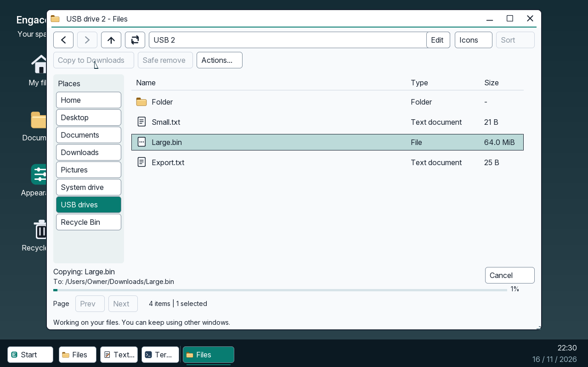

# Engacer OS M12.7 / 0.12.7 - File commands and transfers

Native qualification passes **M12-STAGE7-VM-v1**.
[Exact-source acceptance](../../evidence/M12/7/acceptance-results.json) verifies
584 compiled Git inputs, fourteen native journeys, real 150%/4K, twelve cached/full
comparisons, matching VMware/BIOS setup and ordinary starts. Actual slot recovery
restores damaged owned BIOS boot bytes and starts independently. [Complete public proof](../../evidence/M12/7/publication-results.json) subsequently
passed before M12.8: twenty assets, 333 pages and 2,262 links. Original release
notes and accepted media remain pinned and unchanged.

Build: `595e94df44cc995c3379d11379f4663e`.
ISO SHA256: `11832944be106bfa560856f4978994a59e17613ddc0c283c1704816e7ff041f2`.
VMware ZIP SHA256: `addfc2f971b5de5407318706febbc73cf69c56df68a1eba741417bb494581476`.

## What changes

The common toolbar and right-click routes share command capability checks.
Actions remains visible at the real 500x420 minimum, including Copy/Cut/Paste,
Rename, Recycle, New folder/text, Undo, Properties and last-transfer details.
System protections, busy guards and owner checks remain effective through keys.

USB Copy to Downloads shares the checked cooperative job and conflict review
with Copy/Paste. A single generation-bound lease reads at most 4096 bytes per
step into the existing buffer. Physically consecutive clusters are coalesced
only after their FAT links are checked; fragmented and unaligned reads preserve
actual order. A 1,568-byte metadata cache avoids repeated mirrored FAT reads.

Progress shows the phase, source and destination, with Cancel and confirmed work.
Minimizing the owner retains global progress and Cancel above the taskbar.
Only the progress strip is damaged during steady work. Completed, cancelled and
stopped jobs retain Details. Native Keep both/Skip/Replace, single-action Undo,
Recycle/Restore, protected locations and partial tree cancellation are checked.
An unfinished destination stream is not published; completed items remain.

The live installer now independently compresses nonzero pages using the checked
bounded private record codec. The loader correctly refused an earlier candidate
that crossed firmware-owned ACPI NVS at 8 MiB; memory ownership checks remain
intact. The final live ELF stays below that boundary. Install/recovery decode
and validate complete pages before destination I/O; a build guard rejects a
future oversized fixed-address image. Installed BIOS layout remains compact.
Use the matching recovery ISO; older media cannot replay new encoded records.
This does not implement arbitrary firmware placement or universal boot support.

[Architecture and choices](../architecture/transfers-m127.md),
[commands and transfers guide](../handbook/transfers-m127.md),
[eight-step installation](../handbook/install-m127.md).

## Qualification and limits

Actual native testing checks a 64-MiB USB copy, cancellation after reading began,
background feedback, native partial completion, source removal and independent
full payload/CRC comparison. The original 1-GiB USB fixture remains unchanged.
The codec host tests check 544 real/generated pages and 10,808 malformed/fuzz
cases with unchanged output guards. Native compressed-slot replay independently
restores deliberately corrupted owned boot bytes and starts without the ISO.

The production old/new FAT32 reader host comparison needs 13.57 times fewer I/O
requests for the same bytes. This is a request-count comparison, not physical
throughput or hardware FPS. The 18.5-second native full-copy observer interval
also includes test input; it is not a storage benchmark.

Fixed shell state stays **545,636 bytes**. Fixed FAT32 state is **9,920 bytes**,
**1,696 above M12.6**, including the 1,568-byte cache. No new persistent payload
buffer is added. Managed pages return to **4,288,512 bytes**, peak **4,337,664**,
with zero retained pages/new allocation failures and halted idle CPUs.
[Resources](../../evidence/M12/7/resources.json) distinguish those values from
configured RAM, live linked ranges and font/device/framebuffer storage.

USB imports remain one-file and at most 64 MiB. Export remains synchronous,
create-only and cannot be cancelled mid-file. USB folders, Cut/Move, overwrite,
format expansion and sorting remain unavailable. Rename/move/recycle clears the
file clipboard under the retained move policy; Copy/Cut again before Paste.

Shared-menu footer fitting and more specific conflict name/provider feedback
remain M12.14; the earlier HiDPI cursor observation remains M12.16. The earlier
concurrent BIOS/AHCI timeout is retained for M12.18; stress reliability remains
unqualified. Final controller/device/original-app regression is M12.18. Physical,
ARM, vendor GPU 3D and universal DOS/Windows compatibility are not claimed.
Agent visual/scenario review is distinct from a human usability study.

