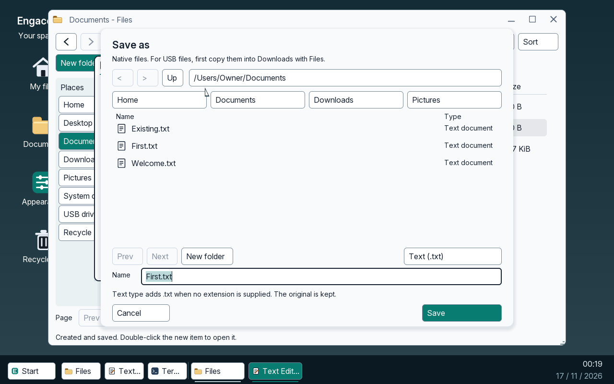

# Engacer OS M12.8 / 0.12.8 - Shared native file dialogs

Native qualification passes **M12-STAGE8-VM-v1**.
[Exact-source acceptance](../../evidence/M12/8/acceptance-results.json) verifies
587 compiled Git inputs and nineteen native scenarios. The exact VMware starter,
separate BIOS setup/ordinary starts, compressed-slot repair, compact light/dark,
actual 150%/4K and twelve cached/full comparisons pass. Public delivery closes
separately before M12.9. [Complete public proof](../../evidence/M12/8/publication-results.json)
subsequently passed: twenty downloads, 337 pages and 2,305 links. Original
release notes/source and accepted media remain pinned and unchanged. See the [current delivery status](https://github.com/enginsoysal/engacer-os/blob/main/docs/roadmap/status.md).

Build: `9a36bb087f5db1ccbfc8510b72794654`.
ISO SHA256: `f4b4d7745782ce9414b8b46d24aba823348cf5a6fa92f06e48aae917a9f82c9a`.
VMware ZIP SHA256: `a0a6bd436efd87c224b5fb193419c6004d096275c9d8941f0892abb83ecd0337`.

## What changes

Text Editor Open/Save as, Image Viewer BMP Open, Archive Manager ZIP Open and
Choose folder share real native navigation, file icons, extension filters,
Back/Forward/Up, an editable location, personal places and New folder. A single
click selects; double-click or Enter opens. Ctrl+O and Ctrl+Shift+S are supported.

Cancel keeps the original document. Dirty Open has explicit Save/Discard/Back/
Cancel review. Existing targets need explicit replacement; changed, protected,
in-use and failed-write targets cannot silently replace work. Extraction creates
a unique new subfolder at the chosen destination and retains the source ZIP.
Successful choices remember separate Open/Save/folder locations in an optional
versioned CRC-checked 792-byte per-user record. Cancel does not update it.

The dialog uses its existing owner even at eight live windows. Other windows
remain usable. Their Open/Save as shortcuts cannot replace the active dialog or
fall through to ordinary Save. Finish/cancel the dialog before display-size
changes. Invalid/oversized/binary text keeps the existing document.

## How and why

Reuse the existing modal broker and shared visual controls instead of another
app window, worker, framebuffer or growing queue. Source identity snapshots and
complete checks precede commits. Checked text blocks reuse the volume scratch
page and existing worker IPC input pages rather than an 8-KiB kernel payload
buffer. Generic Tab uses two bounded scans rather than reserving another 8-KiB
array on every key. The guarded 16-KiB stack stays unchanged. Native ZIP/Enter
and multi-page CPL3 text loading pass; failed prototypes remain in diagnostics.

[Fixed and managed memory](../../evidence/M12/8/resources.json): fixed shell
state is 552085 bytes, 6449 above M12.7. Normal managed pages return from
4288512 to the same number of bytes after closing; measured
peak is 4583424 bytes across the multi-window tasks. No new
kernel document payload buffer or per-window raster cache is allocated. Font
bytes are unchanged. Configured VM RAM is not measured OS consumption.

## Verification

Native tasks check successful/cancelled saves, changed-target review, dirty work,
filters, real small binary/oversized sources, protected destinations and invalid
names. Every rejected choice leaves the complete owned disk unchanged. Actual
injected write faults and invalid preference clones keep work and their original
base disk. Independent GPT/metadata/data CRC reads match all stored documents
and every extracted ZIP member. Tasks retain zero managed pages/new failures.

Five display routes include compact 800x600 light/dark, 1920x1200/150% and
3840x2160/200%. At 1280x1024 the existing global scale rule refuses 200% and keeps
100% with an explanation; that is a refusal test, not a 200% or exact-minimum
qualification. Idle CPUs halt. Individual compile-only stack frames supplement
actual native tasks; they are not a complete worst-case stack proof or a human
usability study. The host decoder passes 551 pages and 10808 malformed/fuzz cases.

## Scope and retained limits

Use the [matching eight-step installation guide](../handbook/install-m128.md)
and [Open/Save/folder instructions](../handbook/dialogs-m128.md). Source,
evidence and twenty matching release assets remain tied to this candidate.

- This is native app integration, not expanded Windows common-dialog compatibility.
- Text remains supported ASCII up to 8191 bytes. Existing BMP/ZIP limits remain.
- Copy USB files into native folders first; direct USB editing/replacement is unavailable.
- Finish/cancel active transfers before opening a picker. Background conflict-review
  arbitration remains an explicit M12.14 integration gate, alongside prior menu feedback.
- Small startup modes versus explicit scale choices and cursor isolation remain M12.16.
- The earlier concurrent BIOS/AHCI timeout remains open for M12.18; stress reliability
  is not qualified. Final controller/original-app regression remains M12.18.
- Physical/ARM, vendor GPU 3D and universal Windows support are not qualified.

