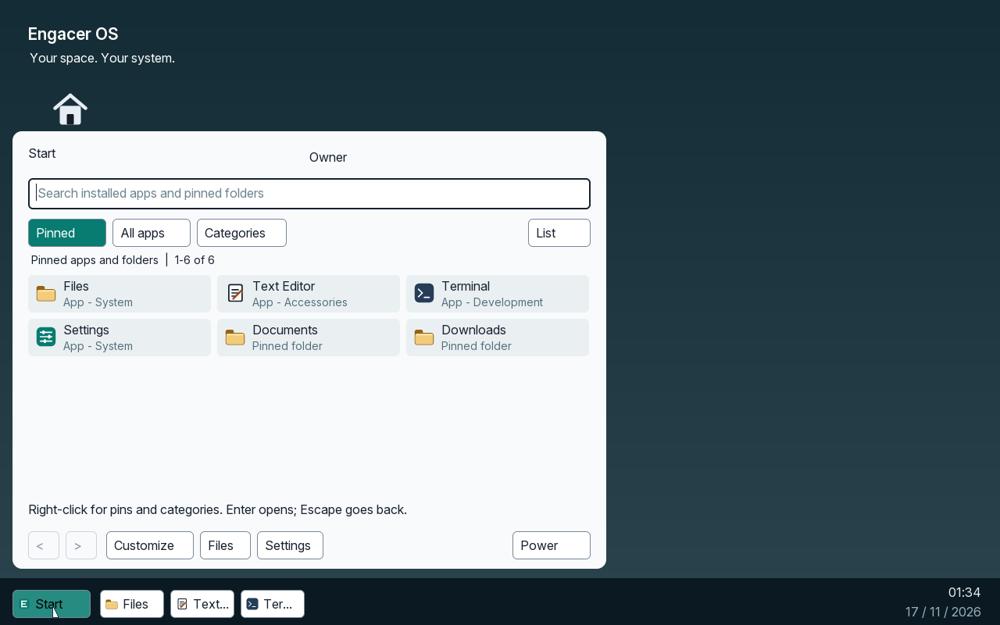

# Engacer OS M12.9 / 0.12.9 - Start and local search

Native qualification passes **M12-STAGE9-VM-v1**. GitHub downloads and complete
public website verification close separately before M12.10.

Build: `9eb7af562b85bcfa14609773dbd1e718`.
ISO SHA256: `b56cefb8eb9d781fa308db1944ae3f60ac760e8d1767e04a93d6249bd888f104`.
VMware ZIP SHA256: `91992a6f77745dc53da7b65a2a30424c14fe3a3c3079155376bf16c1323db0bb`.

## What changes

Start is more compact and uses the shared original app/folder icons. A heading
identifies Pinned, Installed apps, the selected category or local search. The
visible result range and total explain when another page is available. Grid
subtitles identify app categories without redundant pin text; full-width
results retain pin status. Search always uses a full-width list.

Local search puts exact labels before prefixes and other partial matches,
with alphabetical ordering within equal ranks. It searches installed apps and
pinned folder/app labels on this device. It does not search the Internet or
index the filesystem. A search keystroke does not launch an app process.

Existing categories, visibility, ordering, renamed pins and taskbar references
keep their validated version-one preference format. Unpinning changes a
reference rather than removing an app or folder. Optional app removal prunes
its references; reinstall restores its catalogue availability. Native folder
pins open their actual paths. Keyboard arrows use the same columns as drawing;
Tab, Enter, Shift+F10 and Escape retain their supported routes.

## How and why

Keep the existing bounded catalogue and preferences instead of adding a second
launcher database, indexing service, worker or raster cache. At most 52 result
references are sorted on demand. Exact/prefix/substring ranking uses the same
validated bounded ASCII labels and query. Panel/control geometry and shared
font/icons are reused. The native visual review widened New category and added
pagination feedback before qualification; its earlier prototype and controlled
test stop remain honest diagnostics, not qualification of the final bytes.

[Design decisions](../architecture/start-m129.md), [Start instructions](../handbook/start-m129.md)
and [eight-step installation](../handbook/install-m129.md).

## Verification

[Exact-source acceptance](../../evidence/M12/9/acceptance-results.json) records
588 compiled Git inputs, native search/launch/category/pin/remove/reinstall/
folder journeys and two ordinary no-ISO starts with independently read exact
preferences. Compact light/dark, actual 150% and physical 3840x2160/200% exercise
Start, local results, context menus, Tab and category review. The exact VMware
starter and separate BIOS paths install and start independently. Twelve cached
versus full movement comparisons and actual compressed boot repair are separate
checks. Host production ranking covers sixteen cases; the actual page decoder
covers 552 pages and 10808 malformed/fuzz cases with unchanged canaries.

[Resources](../../evidence/M12/9/resources.json) separate fixed state, peak and
retained managed pages. Fixed shell state remains 552085 bytes, unchanged from
M12.8; shared font bytes are unchanged. Tasks return their managed pages
and CPUs halt at idle. Configured guest RAM is not measured OS consumption.

## Scope and retained limits

- Search covers installed catalogue/pinned labels, not all files or online services.
- This stage retains the native app, file-provider and format limits. It does not
  expand Windows compatibility or qualify Steam/vendor GPU 3D.
- Taskbar redesign follows separately in M12.10; later stages close in order.
- Clear the query before changing browse view/category. Search stays global and
  full-width; clarifying those affordances is retained for M12.14 feedback.
- Finish/cancel transfers before opening a picker. Menu/conflict feedback and
  background transfer/modal arbitration remain M12.14 integration work.
- Small startup/explicit scaling reconciliation and cursor isolation remain M12.16.
- The earlier concurrent BIOS/AHCI observation and complete final controller/
  original-app matrix remain M12.18. Stress reliability is not established here.
- Physical/ARM and universal hardware/Windows support remain unqualified.
- Agent visual/scenario review is not a human usability study. GitHub downloads
  and complete website proof close separately before the next stage.

